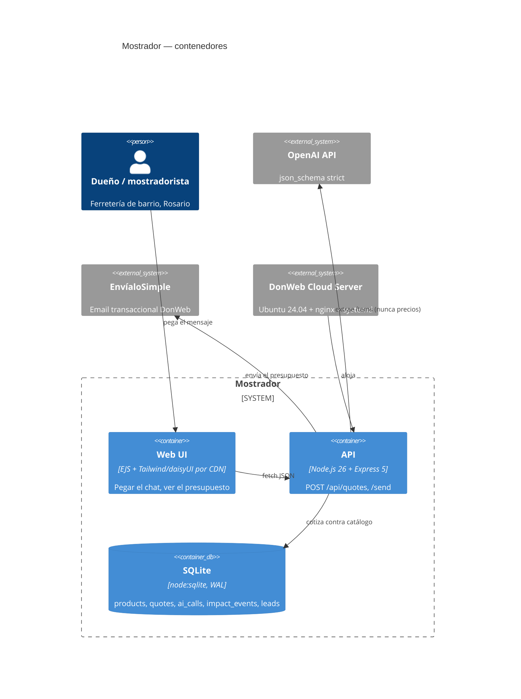

# Plan — "Mostrador" · DonWeb Day Rosario hackathon · build + browser-verify by ~17:30

**T0 = 2026-11-01 16:00 (-03). Hard internal deadline: 17:30 (build complete + verified in browser + deploy assets ready). External deadline: 18:30 (public URL live).**

---

## 0. Goal

Build, commit and browser-verify a complete Node.js/Express + OpenAI + SQLite web app — **Mostrador**, an AI counter clerk for a Rosario hardware store (*ferretería*) that turns a messy WhatsApp message into a priced, emailed `presupuesto` in under 40 seconds — inside the `donweb-winning-pipeline` repo layout from `README (8).md`, finished and deploy-ready by 17:30 so Luna can spend 17:30→18:00 on the actual DonWeb deploy and 18:00→18:30 on manual verification of the public URL.

---

## 1. Current context (verified on this host, 15:55–15:57)

| Fact | Value | How verified |
|---|---|---|
| Working dir | `/home/luna/proyectohackhaton` | `pwd` |
| State | **Empty**, not a git repo | `ls -la`, `git status` → `fatal: not a git repository` |
| Node / npm | `v26.11.1` (ABI **147**) / `12.2.0` | `node -v` |
| `node:sqlite` built-in | **works** (`DatabaseSync` in-memory probe OK) | `node -e` probe |
| `better-sqlite3` latest | `13.0.3`, `engines.node >=22`; **no prebuild for ABI 147** → would need a native compile | `npm view` + GitHub releases probe |
| Latest packages | express `5.3.0`, zod `4.6.7`, openai `7.47.0`, ejs `7.0.2` | `npm view <pkg> version` |
| git identity | `JuanLunaIA <127159163+JuanLunaIA@users.noreply.github.com>` | `git config --global` |
| `gh` auth | logged in `JuanLunaIA`, scopes include `repo` (HTTPS push) | `gh auth status` |
| Browser | Browser-Use Chromium reachable, `about:blank` OK, viewport 1280×577 | `browser_exec` probe |
| `OPENAI_API_KEY` | **absent on disk** | grep of `~/.env*`, `~/.config`, project dirs |
| `ENVIALOSIMPLE_API_KEY` | **absent on disk** | same |
| DonWeb Cloud Server (IP/SSH port) | **not on disk** — Luna has it in the DonWeb panel | `~/.ssh/known_hosts` has no `dattaweb`/`donweb` entries |
| EnvíaloSimple endpoint | `POST https://api.envialosimple.email/api/v1/mail/send`, `Authorization: Bearer`, `Content-Type: application/json`; body `{from,to,subject,html\|text\|templateID, preview_text?, context?/substitutions?, attachments?}`; **no CC/BCC**; max 10 recipients (`to` array), 15 MB/attachment | support doc `16040497` + product page |
| EnvíaloSimple alt host | `https://backend.envialosimple.email/api/v1/mail/send` (used by the marketing product page) → keep base configurable with fallback | web search result #5/#6 |
| DonWeb deploy | 3 steps; **SSH port ≠ 22**; panel-managed firewall (**never install ufw**); nginx → app on `127.0.0.1:PORT`; DB localhost-only | `donweb.com/es-int/cloud-server-con-despliegue-ia` (fetched) |

### Inputs from the user's files

- `/home/luna/promt.md` (identical to `promt.txt`) = the **THEME-TO-VICTORY** meta-prompt. Filled inputs: *consigna* = "un negocio local pierde ventas porque atiende consultas y pedidos a mano, por whatsapp o por teléfono"; *subtema/ángulo* = **"el que quieras elegir de vos personalmente"**; *enfoque* = **"lo que se te ocurra personalmente"**. → **The plan chooses.** Decision in §2. It mandates: Node/Express, Tailwind+daisyUI by CDN, OpenAI `response_format: json_schema` `strict:true` + zod + 1 repair retry + deterministic fallback with a visible "modo degradado" badge, SSE streaming, `better-sqlite3` (WAL + `foreign_keys ON`), tables `impact_events`/`ai_calls`/`leads` + domain tables, EnvíaloSimple for email, prompts as versioned `.md` in `src/prompts/`, 5 golden evals in `prompts/evals/`, 17:20 core-flow checkpoint + cut rule.
- `/home/luna/Downloads/README (8).md` = the **repo shape** (`donweb-winning-pipeline`): `context/{raw,chunks,digests,index}`, `prompts/{system,deploy,generation,evals}`, `src/{routes,services,prompts,views,db,lib}`, `docs/{pitch,architecture,business,impact}`, `deploy/`, `tools/`, `checklist/`.
- `/home/luna/Downloads/donweb-day-dossier.md` (319 lines, read in full) = evidence layer: judging weights 35/30/25/10, jury profiles, INDEC/CAF numbers, C4/Mermaid, Chain of Change, IRIS+ indicator names, 3-min pitch timing, deploy prompt text.

### Assumptions (explicit — correct me if wrong, but the build does not block on any of them)

| # | Assumption | Tag | If wrong |
|---|---|---|---|
| A1 | Luna is at the event, clock is live, commits from T0 onward count as in-event per §3.6 | `[STRONG_INFERENCE]` | If not, the repo is just a working demo; nothing breaks |
| A2 | The org-provided OpenAI key will be pasted into `.env` before the live demo | `[UNKNOWN]` | App runs in `degraded` mode end-to-end; browser verification still passes; UI shows an honest badge |
| A3 | No EnvíaloSimple account yet → email runs in `mock` mode by default | `[STRONG_INFERENCE]` | One env flip (`EMAIL_MODE=live`) switches to the real API; client is written against the published contract |
| A4 | DonWeb Cloud Server exists but its IP/SSH-port are only in Luna's panel | `[UNKNOWN]` | Deploy (§8) is out of this plan's critical path |
| A5 | Node 26 has no `better-sqlite3` prebuild → `node:sqlite` is the safe driver | `[STRONG_INFERENCE]` | `src/db.js` tries `better-sqlite3` first and transparently falls back — both paths work |

---

## 2. Architecture / approach

One repo, one process, three screens. The **load-bearing decision**: **the LLM extracts, the catalogue prices.** The model is only allowed to return *descriptions, quantities, unit and customer contact* — never a price or a SKU it made up; a deterministic matcher (`src/services/catalog.js`) binds each extracted line to a real catalogue row and computes `total_ars`. That kills the 25%-criterion failure mode ("the AI invented the numbers") and gives a second demonstrable quality: an item with `confianza < 0.55` renders as `requiere_revision` instead of silently mispricing. Everything else is deliberately boring: server-rendered EJS + Tailwind/daisyUI by CDN (no bundler, no SPA), SQLite on local file (WAL + `foreign_keys ON`), one `POST /api/quotes` endpoint, and an `ai_calls` audit row for every model call so "calidad de la IA" is inspectable in the UI, not asserted in the pitch.

**Product choice (mine, per the prompt's "elegí vos"):** *ferretería de barrio*. Reason, 2 lines: it is the only angle where the artefact (a **presupuesto**) is simultaneously the money artefact, the WhatsApp pain, the email payload and the measurable unit ("4 h/semana → 20 min" is already the dossier's Chain-of-Change row #1) — a restaurant order or a hair-salon booking produces a weaker artefact and a weaker email story.

**Name:** `Mostrador` — *"el mostrador de tu ferretería que nunca duerme"*.

### ADR-001 · `node:sqlite` with `better-sqlite3` first
`promt.md` pins `better-sqlite3`. Node 26 (ABI 147) has no prebuild, so `npm i` would trigger a native compile that can fail on a fresh box mid-event. `src/db.js` requires `better-sqlite3` and falls back to `node:sqlite` (same `prepare/run/all/get/exec` surface, zero deps). Invariant to keep the adapter honest: **positional `?` parameters only, never named params.**
### ADR-002 · No SSE in the MVP
`promt.md` asks for SSE streaming. A quote is a 2–4 s structured JSON call; streaming tokens of a JSON object buys nothing on screen and costs the one thing we do not have. `POST /api/quotes` returns 201 with the finished artefact; the UI shows a staged progress indicator. Revisit only if the AI call exceeds 6 s.
### ADR-003 · Email client written live-first, defaulting to mock
`src/services/email.js` implements the real EnvíaloSimple request exactly as documented, and a `mock` mode that writes the same HTML to `data/outbox/<token>.html` served at `/outbox/:token`. The UI always states which mode ran. No pretend-live.
### ADR-004 · One repo, product at the root
`README (8).md` describes a knowledge base. A jury that opens a repo full of PDFs gets a pipeline, not a product. The app lives at the root; the knowledge base is compressed to `context/digests/` (5 cards) + `prompts/` + `docs/`. Deviation is declared in the repo README itself.

---

## 3. Time budget (T0 = 16:00)

| Block | Window | Output | Gate |
|---|---|---|---|
| P0 | 16:00–16:08 | repo, deps, `.env.example`, commit 1, `gh repo create` + push | `npm test` runs, `git log` shows 1 commit, remote exists |
| P1 | 16:08–16:20 | `src/db.js`, `src/schema.sql`, `src/seed.js`, `src/services/impact.js` | `node src/seed.js` prints 15 products, `sqlite3` shows 5 tables |
| P2 | 16:20–16:37 | `src/prompts/extraer-pedido.v1.md`, `src/services/ai.js`, `src/services/catalog.js`, tests | `npm test` green: matcher + degraded extractor + zod schema |
| P3 | 16:37–16:56 | `app.js`, `src/routes/*.js`, `src/views/*.ejs`, `public/` | `curl :3000/healthz` → `{"ok":true,...}`; `/` renders 200 |
| P4 | 16:56–17:06 | `src/services/email.js`, `prompts/evals/{cases.json,run.js}` | `npm run evals` → 5/5 PASS table |
| P5 | 17:06–17:20 | **browser E2E** (click-through, screenshots) + fixes | §7 checklist all PASS |
| P6 | 17:20–17:32 | `README.md`, `docs/**`, `context/digests/*`, `deploy/**`, `checklist/**` | `jq . context/index/manifest.json` valid; README renders on GitHub |
| Buffer | 17:32–17:40 | commit `feat: ready to deploy`, tag `v0.9-deploy-ready` | `git status` clean, pushed |

P6 runs **in parallel** as a delegated subagent from 16:22 (owns `docs/`, `context/digests/`, `checklist/` only — it must not touch `src/`). I own `README.md`, `deploy/`, and all of `src/`.

**Cut rule (hard, per promt.md §H):** if at 17:20 `/api/quotes` does not return a priced quote end-to-end, delete `/impacto` and `/q/:token` from the nav, keep `/` only, and ship the single-screen flow. Deploy beats features — §3.7 is binary.

---

## 4. Step-by-step tasks

> Every command below runs from `/home/luna/proyectohackhaton` unless stated. Every task ends with a commit. `set -e` is assumed by habit.

### P0 — Scaffold, deps, remote (8 min)

**P0.1 — Init repo + ignore rules**

```bash
cd /home/luna/proyectohackhaton
git init -b main
mkdir -p src/{routes,services,prompts,views/partials} public prompts/evals docs/{pitch,architecture,business,impact} deploy context/{digests,index} checklist tests data
```

`/home/luna/proyectohackhaton/.gitignore`:

```gitignore
node_modules/
.env
data/*.sqlite
data/*.sqlite-*
data/outbox/
*.log
.DS_Store
context/raw/
```

**P0.2 — `package.json`** (versions resolved live, not pinned by hand — Luna's standing rule)

`/home/luna/proyectohackhaton/package.json`:

```json
{
  "name": "mostrador",
  "version": "0.1.0",
  "private": true,
  "description": "Mostrador — el mostrador de tu ferreteria que nunca duerme. DonWeb Day Rosario 2026.",
  "main": "app.js",
  "engines": { "node": ">=22" },
  "scripts": {
    "start": "node app.js",
    "dev": "node --watch app.js",
    "test": "node --test tests/",
    "evals": "node prompts/evals/run.js",
    "seed": "node src/seed.js"
  }
}
```

```bash
npm install express zod openai ejs --save 2>&1 | tail -5
npm pkg get dependencies    # record the resolved versions in README P6
```

Expected: `node_modules/` created, `package-lock.json` written, `npm pkg get dependencies` prints the 4 packages with `^` ranges.

**P0.3 — `.env.example` + `.env`**

`/home/luna/proyectohackhaton/.env.example`:

```bash
# --- servidor ---
PORT=3000
NODE_ENV=development

# --- IA (clave provista por la organización, SOLO para la IA del producto) ---
OPENAI_API_KEY=
OPENAI_MODEL=            # vacío = autodetecta (gpt-4o-mini → gpt-4.1-mini → gpt-5-mini → gpt-4o)
AI_TIMEOUT_MS=20000

# --- email (EnvíaloSimple Transaccional) ---
EMAIL_MODE=mock          # mock | live
ENVIALOSIMPLE_API_KEY=
ENVIALOSIMPLE_FROM=      # debe ser un dominio verificado en la cuenta
ENVIALOSIMPLE_BASE=https://api.envialosimple.email

# --- base de datos ---
DB_PATH=data/mostrador.sqlite
```

```bash
cp .env.example .env
node -e "require('node:fs').readFileSync('.env','utf8').includes('EMAIL_MODE=mock')&&console.log('env ok')"
```

Expected: `env ok`.

**P0.4 — Commit 1 + remote**

```bash
git add -A && git commit -q -m "chore: scaffold mostrador (express+zod+openai+ejs), env contract, gitignore"
gh repo create mostrador --public --source=. --remote=origin --push --description "Mostrador IA — presupuestos de ferreteria desde un audio de WhatsApp. DonWeb Day Rosario 2026" 2>&1 | tail -3
git log --oneline; git remote -v
```

Expected: `gh` prints the repo URL; `git log --oneline` shows 1 commit; `git remote -v` shows `origin https://github.com/JuanLunaIA/mostrador.git`.

> **Why now:** §3.5 requires a public repo. Pushing at 16:08 means a dead laptop at 18:20 still has a valid submission. Push after every commit from here on (`git push -q`).

---

### P1 — Data layer (12 min)

**P1.1 — Write the failing test first**

`/home/luna/proyectohackhaton/tests/db.test.js`:

```js
'use strict';
const test = require('node:test');
const assert = require('node:assert');
process.env.DB_PATH = ':memory:';
const { db, driver } = require('../src/db');

test('schema: las 5 tablas existen y foreign_keys esta ON', () => {
  const names = db.prepare("select name from sqlite_master where type='table' order by name").all().map(r => r.name);
  for (const t of ['ai_calls', 'impact_events', 'leads', 'products', 'quotes']) {
    assert.ok(names.includes(t), `falta tabla ${t} (driver=${driver})`);
  }
  assert.strictEqual(db.prepare('PRAGMA foreign_keys').get().foreign_keys, 1);
});

test('fk: un impact_event sin quote valido debe fallar', () => {
  assert.throws(() => db.prepare('insert into impact_events (quote_id, tipo) values (?,?)').run(999999, 'x'));
});
```

```bash
node --test tests/ 2>&1 | tail -8
```

Expected **failure**: `Cannot find module '../src/db'`. (This is the TDD gate — do not skip.)

**P1.2 — `src/db.js`**

```js
'use strict';
const path = require('node:path');
const fs = require('node:fs');

const DB_PATH = process.env.DB_PATH || path.join(__dirname, '..', 'data', 'mostrador.sqlite');
if (DB_PATH !== ':memory:') fs.mkdirSync(path.dirname(DB_PATH), { recursive: true });

function open() {
  try {
    const Better = require('better-sqlite3');
    return { db: new Better(DB_PATH), driver: 'better-sqlite3' };
  } catch {
    const { DatabaseSync } = require('node:sqlite');
    return { db: new DatabaseSync(DB_PATH), driver: 'node:sqlite' };
  }
}

const { db, driver } = open();
db.exec('PRAGMA journal_mode = WAL;');
db.exec('PRAGMA foreign_keys = ON;');

if (DB_PATH === ':memory:') db.exec(fs.readFileSync(path.join(__dirname, 'schema.sql'), 'utf8'));

module.exports = { db, driver, DB_PATH };
```

**P1.3 — `src/schema.sql`**

```sql
CREATE TABLE IF NOT EXISTS products (
  sku        TEXT PRIMARY KEY,
  nombre     TEXT NOT NULL,
  unidad     TEXT NOT NULL,
  precio_ars INTEGER NOT NULL CHECK (precio_ars >= 0),
  aliases    TEXT NOT NULL DEFAULT ''
);

CREATE TABLE IF NOT EXISTS quotes (
  id             INTEGER PRIMARY KEY AUTOINCREMENT,
  token          TEXT NOT NULL UNIQUE,
  created_at     TEXT NOT NULL DEFAULT (datetime('now')),
  raw_text       TEXT NOT NULL,
  customer_name  TEXT,
  customer_phone TEXT,
  customer_email TEXT,
  items_json     TEXT NOT NULL,
  total_ars      INTEGER NOT NULL DEFAULT 0,
  ai_mode        TEXT NOT NULL,              -- 'live' | 'degraded'
  ai_latency_ms  INTEGER NOT NULL DEFAULT 0,
  status         TEXT NOT NULL DEFAULT 'draft',  -- draft | sent
  sent_at        TEXT
);

CREATE TABLE IF NOT EXISTS ai_calls (
  id               INTEGER PRIMARY KEY AUTOINCREMENT,
  quote_id         INTEGER REFERENCES quotes(id) ON DELETE CASCADE,
  model            TEXT,
  mode             TEXT NOT NULL,
  prompt_tokens    INTEGER NOT NULL DEFAULT 0,
  completion_tokens INTEGER NOT NULL DEFAULT 0,
  latency_ms       INTEGER NOT NULL DEFAULT 0,
  schema_ok        INTEGER NOT NULL DEFAULT 0,
  repair_attempts  INTEGER NOT NULL DEFAULT 0,
  error            TEXT,
  created_at       TEXT NOT NULL DEFAULT (datetime('now'))
);

CREATE TABLE IF NOT EXISTS impact_events (
  id               INTEGER PRIMARY KEY AUTOINCREMENT,
  quote_id         INTEGER REFERENCES quotes(id) ON DELETE CASCADE,
  tipo             TEXT NOT NULL,            -- presupuesto_emitido | email_enviado
  minutos_ahorrados INTEGER NOT NULL DEFAULT 0,
  monto_ars        INTEGER NOT NULL DEFAULT 0,
  created_at       TEXT NOT NULL DEFAULT (datetime('now'))
);

CREATE TABLE IF NOT EXISTS leads (
  id         INTEGER PRIMARY KEY AUTOINCREMENT,
  quote_id   INTEGER REFERENCES quotes(id) ON DELETE SET NULL,
  email      TEXT NOT NULL,
  nombre     TEXT,
  origen     TEXT NOT NULL DEFAULT 'demo',
  created_at TEXT NOT NULL DEFAULT (datetime('now'))
);

CREATE INDEX IF NOT EXISTS idx_quotes_token ON quotes(token);
CREATE INDEX IF NOT EXISTS idx_impact_created ON impact_events(created_at);
```

```bash
node --test tests/ 2>&1 | tail -8
```

Expected: `# pass 2` / `# fail 0`, driver reported in the failure message would be `node:sqlite` if `better-sqlite3` is absent.

**P1.4 — `src/seed.js`** (15 products, realistic Rosario ARS prices for Nov 2026)

```js
'use strict';
const fs = require('node:fs');
const path = require('node:path');
const { db, driver, DB_PATH } = require('./db');

// idempotente: CREATE TABLE IF NOT EXISTS
db.exec(fs.readFileSync(path.join(__dirname, 'schema.sql'), 'utf8'));

const PRODUCTS = [
  ['TOR-8x2',   'Tornillo autoperforante 8 x 2"',        'unidad',  45,  'tornillo tirafondo autoperforante 8x2 pulgadas'],
  ['TOR-8x3',   'Tornillo autoperforante 8 x 3"',        'unidad',  68,  'tornillo tirafondo autoperforante 8x3 pulgadas'],
  ['CAB-2x15',  'Cable taller 2x1.5 mm',                 'metro',   1290,'cable 2x1.5 2x1,5 bipolar mellizo'],
  ['CAB-2x25',  'Cable taller 2x2.5 mm',                 'metro',   1980,'cable 2x2.5 2x2,5 bipolar mellizo'],
  ['LLA-PAS12', 'Llave de paso 1/2"',                    'unidad',  4350,'llave paso media pulgada esferica agua'],
  ['LLA-PAS34', 'Llave de paso 3/4"',                    'unidad',  6900,'llave paso tres cuartos esferica agua'],
  ['CEM-50',    'Cemento Loma Negra 50 kg',              'bolsa',   9800,'cemento bolsa 50kg loma negra cal'],
  ['HIE-8',     'Hierro del 8 (diam. 8 mm) x 12 m',      'barra',   7450,'hierro construccion 8mm barra 12 metros'],
  ['HIE-10',    'Hierro del 10 (diam. 10 mm) x 12 m',    'barra',   11200,'hierro construccion 10mm barra 12 metros'],
  ['PIN-LAT20', 'Pintura latex interior 20 L',           'balde',   58900,'pintura latex 20 litros interior blanca'],
  ['PIN-SIN4',  'Pintura sintetica 4 L',                 'lata',    24300,'pintura sintetica esmalte 4 litros'],
  ['BRO-2',     'Brocha 2" cerda natural',               'unidad',  3200,'brocha pincel 2 pulgadas'],
  ['ROD-9',     'Rodillo antigota 22 cm',                'unidad',  5100,'rodillo pintura antigota 22cm'],
  ['SIL-300',   'Silicona neutra 300 ml',                'cartucho',4800,'silicona sellador neutro cartucho 300ml'],
  ['GUA-REF',   'Guantes de trabajo reforzados',         'par',     3600,'guantes trabajo cabritilla reforzado'],
];

db.exec('BEGIN');
const stmt = db.prepare('INSERT OR REPLACE INTO products (sku,nombre,unidad,precio_ars,aliases) VALUES (?,?,?,?,?)');
for (const p of PRODUCTS) stmt.run(...p);
db.exec('COMMIT');

const n = db.prepare('select count(*) as n from products').get().n;
console.log(`seed ok: ${n} productos en ${DB_PATH} (driver=${driver})`);
```

> **Implementer note:** the array above is complete and syntactically valid as printed — copy it verbatim. `INSERT OR REPLACE` makes the seed idempotent, so it is safe to re-run after a typo in a price.

```bash
node src/seed.js
```

Expected: `seed ok: 15 productos en .../data/mostrador.sqlite (driver=node:sqlite)`

**P1.5 — `src/services/impact.js`**

```js
'use strict';
const { db } = require('../db');

const MINUTOS_AHORRADOS_POR_PRESUPUESTO = 18; // baseline 20 min a mano -> 2 min con Mostrador

function logQuote(quote) {
  db.prepare(
    'INSERT INTO impact_events (quote_id, tipo, minutos_ahorrados, monto_ars) VALUES (?,?,?,?)'
  ).run(quote.id, 'presupuesto_emitido', MINUTOS_AHORRADOS_POR_PRESUPUESTO, quote.total_ars);
}

function logEmail(quote) {
  db.prepare(
    'INSERT INTO impact_events (quote_id, tipo, minutos_ahorrados, monto_ars) VALUES (?,?,?,?)'
  ).run(quote.id, 'email_enviado', 0, quote.total_ars);
}

function counters() {
  const presupuestos = db.prepare("select count(*) n, coalesce(sum(monto_ars),0) monto from impact_events where tipo='presupuesto_emitido'").get();
  const emails = db.prepare("select count(*) n from impact_events where tipo='email_enviado'").get();
  const minutos = db.prepare('select coalesce(sum(minutos_ahorrados),0) m from impact_events').get();
  const leads = db.prepare('select count(*) n from leads').get();
  return {
    presupuestos: presupuestos.n,
    monto_ars: presupuestos.monto,
    emails: emails.n,
    minutos_ahorrados: minutos.m,
    horas_ahorradas: Math.round((minutos.m / 60) * 10) / 10,
    leads: leads.n,
  };
}

module.exports = { logQuote, logEmail, counters, MINUTOS_AHORRADOS_POR_PRESUPUESTO };
```

```bash
git add -A && git commit -q -m "feat(db): schema sqlite (products/quotes/ai_calls/impact_events/leads) + driver adapter + seed + impacto" && git push -q
```

Expected: commit created, push silent.

---

### P2 — AI service + catalogue matcher (17 min)

**P2.1 — Failing tests first**

`/home/luna/proyectohackhaton/tests/catalog.test.js`:

```js
'use strict';
const test = require('node:test');
const assert = require('node:assert');
const { matchItem } = require('../src/services/catalog');

const PRODUCTS = [
  { sku: 'TOR-8x2', nombre: 'Tornillo autoperforante 8 x 2"', unidad: 'unidad', precio_ars: 45, aliases: 'tornillo tirafondo 8x2 pulgadas' },
  { sku: 'CAB-2x15', nombre: 'Cable taller 2x1.5 mm', unidad: 'metro', precio_ars: 1290, aliases: 'cable 2x1.5 bipolar' },
  { sku: 'CEM-50', nombre: 'Cemento Loma Negra 50 kg', unidad: 'bolsa', precio_ars: 9800, aliases: 'cemento bolsa 50kg' },
];

test('matchea tornillo 8x2 y devuelve precio del catalogo', () => {
  const m = matchItem('tornillos del 8 x 2 pulgadas', PRODUCTS);
  assert.strictEqual(m.sku, 'TOR-8x2');
  assert.strictEqual(m.precio_ars, 45);
  assert.ok(m.confianza >= 0.55);
});

test('matchea cable 2x1,5 (coma decimal argentina)', () => {
  const m = matchItem('5 metros de cable 2x1,5', PRODUCTS);
  assert.strictEqual(m.sku, 'CAB-2x15');
});

test('descripcion fuera de catalogo -> sku null, no inventa precio', () => {
  const m = matchItem('amalgama dental de mercurio', PRODUCTS);
  assert.strictEqual(m.sku, null);
  assert.strictEqual(m.precio_ars, 0);
  assert.strictEqual(m.requiere_revision, true);
});
```

`/home/luna/proyectohackhaton/tests/extract.test.js`:

```js
'use strict';
const test = require('node:test');
const assert = require('node:assert');
const { degradeExtract } = require('../src/services/ai');

test('degradado: extrae cantidad + descripcion de un mensaje de WhatsApp', () => {
  const out = degradeExtract('hola tenes 200 tornillos del 8x2 y 5 metros de cable 2x1,5?');
  assert.ok(out.items.length >= 2, `items=${JSON.stringify(out.items)}`);
  const tor = out.items.find(i => /tornillo/i.test(i.descripcion_raw));
  assert.ok(tor, 'no extrajo tornillos');
  assert.strictEqual(tor.cantidad, 200);
});

test('degradado: texto vacio -> missing_fields, no excepcion', () => {
  const out = degradeExtract('');
  assert.deepStrictEqual(out.items, []);
  assert.ok(out.missing_fields.includes('descripcion'));
});
```

```bash
node --test tests/ 2>&1 | tail -12
```

Expected **failure**: `Cannot find module '../src/services/catalog'` and `'../src/services/ai'`.

**P2.2 — `src/services/catalog.js`**

```js
'use strict';

const STOP = new Set(['de','del','la','el','los','las','un','una','unos','unas','y','por','para','con','que','me','mi','necesito','quiero','pasame','precio','cuanto','sale','salen','hola','buenas','tengo','tenes','hay','seria','son','es','al','a','en','x']);

function norm(s) {
  return String(s || '')
    .toLowerCase()
    .normalize('NFD').replace(/[\u0300-\u036f]/g, '')
    .replace(/,/g, '.')
    .replace(/[^a-z0-9.\s]/g, ' ')
    .replace(/\s+/g, ' ')
    .trim();
}

function tokens(s) {
  return norm(s).split(' ').filter(t => t.length >= 2 && !STOP.has(t));
}

function matchItem(descripcion, productos, umbral = 0.55) {
  const q = tokens(descripcion);
  let best = { sku: null, nombre: null, unidad: null, precio_ars: 0, confianza: 0, matched_on: [] };
  if (!q.length) return { ...best, requiere_revision: true };

  for (const p of productos) {
    const hay = new Set(tokens(`${p.nombre} ${p.aliases || ''}`));
    const hit = q.filter(t => hay.has(t));
    if (!hit.length) continue;
    const cobertura = hit.length / q.length;          // cuanto de la consulta explica
    const precision = hit.length / Math.max(hay.size, 1); // cuanto del producto se usa
    const confianza = Math.round((cobertura * 0.8 + precision * 0.2) * 100) / 100;
    if (confianza > best.confianza) {
      best = { sku: p.sku, nombre: p.nombre, unidad: p.unidad, precio_ars: p.precio_ars, confianza, matched_on: hit };
    }
  }
  if (best.confianza < umbral) {
    return { sku: null, nombre: null, unidad: null, precio_ars: 0, confianza: best.confianza, matched_on: best.matched_on, requiere_revision: true };
  }
  return { ...best, requiere_revision: false };
}

function loadProducts(db) {
  return db.prepare('select sku, nombre, unidad, precio_ars, aliases from products').all();
}

module.exports = { matchItem, loadProducts, norm, tokens };
```

```bash
node --test tests/catalog.test.js 2>&1 | tail -8
```

Expected: `# pass 3` / `# fail 0`.

**P2.3 — `src/prompts/extraer-pedido.v1.md`** (the versioned prompt — auditable evidence for the 25%)

```markdown
---
id: extraer-pedido
version: 1
model_target: chat.completions
response_format: json_schema (strict: true)
updated: 2026-11-01
---

# Rol
Sos el mostrador de una ferretería de barrio de Rosario. Recibís un mensaje de WhatsApp de un cliente y lo convertís en líneas de pedido estructuradas.

# Reglas absolutas
1. **Nunca inventes precios.** No devuelvas dinero, totales ni precios por ítem. El sistema cotiza contra el catálogo real.
2. **Nunca inventes un SKU.** `sku_sugerido` es solo una pista textual de lo que dijo el cliente; el catálogo decide.
3. Si una cantidad no está explícita, asumí `1` y agregá `"cantidad"` a `missing_fields`.
4. Si el mensaje no contiene ningún pedido concreto, devolvé `items: []` y `missing_fields: ["descripcion"]`.
5. Copiá `descripcion_raw` **literal** como lo escribió el cliente (sin corregir ortografía ni normalizar unidades).
6. Español rioplatense. No agregues explicaciones fuera del JSON.

# Unidades válidas
`unidad | metro | bolsa | barra | balde | lata | cartucho | par | kg | litro`
Si el cliente dice "metros", "m" o "mts" → `metro`. "bolsas" → `bolsa`.

# Contacto
Extraé `cliente.nombre`, `cliente.telefono` y `cliente.email` solo si están escritos explícitamente en el mensaje. Si no, `null`.

# Ejemplos
**Entrada:** `hola tenes 200 tornillos del 8x2 y 5 metros de cable 2x1,5? cuanto sale todo`
**Salida:** `{"items":[{"descripcion_raw":"tornillos del 8x2","cantidad":200,"unidad":"unidad","sku_sugerido":"tornillo 8x2"},{"descripcion_raw":"cable 2x1,5","cantidad":5,"unidad":"metro","sku_sugerido":"cable 2x1.5"}],"cliente":{"nombre":null,"telefono":null,"email":null},"missing_fields":[],"notas":null}`

**Entrada:** `buenas`
**Salida:** `{"items":[],"cliente":{"nombre":null,"telefono":null,"email":null},"missing_fields":["descripcion"],"notas":"El cliente saludó pero no pidió nada."}`
```

**P2.4 — `src/services/ai.js`**

```js
'use strict';
const fs = require('node:fs');
const path = require('node:path');
const { z } = require('zod');

const SYSTEM_PROMPT = fs.readFileSync(
  path.join(__dirname, '..', 'prompts', 'extraer-pedido.v1.md'), 'utf8'
);

// ---------- contrato de salida ----------
const ItemSchema = z.object({
  descripcion_raw: z.string().min(1),
  cantidad: z.number().positive(),
  unidad: z.string().min(1),
  sku_sugerido: z.string().nullable(),
});
const SalidaSchema = z.object({
  items: z.array(ItemSchema),
  cliente: z.object({
    nombre: z.string().nullable(),
    telefono: z.string().nullable(),
    email: z.string().nullable(),
  }),
  missing_fields: z.array(z.string()),
  notas: z.string().nullable(),
});

const JSON_SCHEMA = {
  type: 'object',
  additionalProperties: false,
  required: ['items', 'cliente', 'missing_fields', 'notas'],
  properties: {
    items: {
      type: 'array',
      items: {
        type: 'object',
        additionalProperties: false,
        required: ['descripcion_raw', 'cantidad', 'unidad', 'sku_sugerido'],
        properties: {
          descripcion_raw: { type: 'string' },
          cantidad: { type: 'number' },
          unidad: { type: 'string' },
          sku_sugerido: { type: ['string', 'null'] },
        },
      },
    },
    cliente: {
      type: 'object',
      additionalProperties: false,
      required: ['nombre', 'telefono', 'email'],
      properties: {
        nombre: { type: ['string', 'null'] },
        telefono: { type: ['string', 'null'] },
        email: { type: ['string', 'null'] },
      },
    },
    missing_fields: { type: 'array', items: { type: 'string' } },
    notas: { type: ['string', 'null'] },
  },
};

// ---------- modo degradado determinístico ----------
const UNIDADES = /(unidades?|u|kg|kilos?|mts?|metros?|bolsas?|barras?|baldes?|latas?|cartuchos?|pares?|pares|litros?|lts?)/i;

function unidadDe(txt) {
  const m = txt.match(UNIDADES);
  if (!m) return 'unidad';
  const u = m[1].toLowerCase();
  if (/^m(ts|etros)?$/.test(u)) return 'metro';
  if (/^bolsa/.test(u)) return 'bolsa';
  if (/^barra/.test(u)) return 'barra';
  if (/^balde/.test(u)) return 'balde';
  if (/^lata/.test(u)) return 'lata';
  if (/^cartucho/.test(u)) return 'cartucho';
  if (/^par/.test(u)) return 'par';
  if (/^(kg|kilo)/.test(u)) return 'kg';
  if (/^(litro|lts?)/.test(u)) return 'litro';
  return 'unidad';
}

function degradeExtract(rawText) {
  const texto = String(rawText || '').trim();
  const base = { items: [], cliente: { nombre: null, telefono: null, email: null }, missing_fields: [], notas: 'Modo degradado: extracción por reglas, sin modelo.' };
  if (!texto) return { ...base, missing_fields: ['descripcion'] };

  const email = (texto.match(/[\w.+-]+@[\w-]+\.[\w.]+/) || [null])[0];
  const tel = (texto.match(/(?:\+?54\s?9?\s?)?\d{2,4}[\s-]?\d{3}[\s-]?\d{4}/) || [null])[0];
  if (email) base.cliente.email = email;
  if (tel) base.cliente.telefono = tel;

  const limpio = texto.replace(/[\w.+-]+@[\w-]+\.[\w.]+/g, ' ');
  const trozos = limpio.split(/\s*(?:,|;|\n|\+|\by\b|\btambien\b|\btambién\b)\s*/i);
  for (const trozo of trozos) {
    const m = trozo.match(/(\d+(?:[.,]\d+)?)\s*(?:x\s*)?([a-záéíóúñ]+)?\s*(?:de\s+)?(.{3,60})/i);
    if (!m) continue;
    const cantidad = Number(String(m[1]).replace(',', '.'));
    const descripcion = String(m[3] || '').replace(/[?.!]+$/, '').trim();
    if (!cantidad || descripcion.length < 3) continue;
    if (/^(hola|buenas|buen dia|buenas tardes|gracias)\b/i.test(descripcion)) continue;
    base.items.push({
      descripcion_raw: descripcion,
      cantidad,
      unidad: unidadDe(`${m[2] || ''} ${trozo}`),
      sku_sugerido: null,
    });
  }
  if (!base.items.length) base.missing_fields.push('descripcion');
  return base;
}

// ---------- cliente OpenAI ----------
let client = null;
let cachedModel = null;

function getClient() {
  if (client) return client;
  if (!process.env.OPENAI_API_KEY) return null;
  const OpenAI = require('openai');
  client = new OpenAI({ apiKey: process.env.OPENAI_API_KEY, timeout: Number(process.env.AI_TIMEOUT_MS || 20000), maxRetries: 0 });
  return client;
}

const PREFERRED = ['gpt-4o-mini', 'gpt-4.1-mini', 'gpt-5-mini', 'gpt-4o'];

async function pickModel(api) {
  if (process.env.OPENAI_MODEL) return process.env.OPENAI_MODEL;
  if (cachedModel) return cachedModel;
  try {
    const list = await api.models.list();
    const ids = new Set(list.data.map(m => m.id));
    cachedModel = PREFERRED.find(m => ids.has(m)) || [...ids].find(m => m.startsWith('gpt-4')) || PREFERRED[0];
  } catch {
    cachedModel = PREFERRED[0];
  }
  return cachedModel;
}

function validar(data) {
  const parsed = SalidaSchema.safeParse(data);
  return parsed.success ? { ok: true, data: parsed.data } : { ok: false, issues: parsed.error.issues };
}

async function callModel(api, model, rawText, extraMessages = []) {
  const t0 = Date.now();
  const r = await api.chat.completions.create({
    model,
    temperature: 0.1,
    messages: [
      { role: 'system', content: SYSTEM_PROMPT },
      ...extraMessages,
      { role: 'user', content: rawText },
    ],
    response_format: { type: 'json_schema', json_schema: { name: 'pedido', strict: true, schema: JSON_SCHEMA } },
  });
  const latency_ms = Date.now() - t0;
  const content = r.choices?.[0]?.message?.content || '';
  let parsed = null;
  try { parsed = JSON.parse(content); } catch { /* cae a validacion */ }
  return {
    parsed,
    meta: {
      model,
      latency_ms,
      prompt_tokens: r.usage?.prompt_tokens || 0,
      completion_tokens: r.usage?.completion_tokens || 0,
    },
  };
}

async function extractOrder(rawText) {
  const api = getClient();
  if (!api) {
    return { data: degradeExtract(rawText), meta: { mode: 'degraded', model: null, latency_ms: 0, prompt_tokens: 0, completion_tokens: 0, repair_attempts: 0, error: 'OPENAI_API_KEY ausente' } };
  }
  const model = await pickModel(api);
  let repair = 0;
  try {
    let { parsed, meta } = await callModel(api, model, rawText);
    let v = validar(parsed);
    if (!v.ok) {
      repair = 1;
      const fix = await callModel(api, model, rawText, [
        { role: 'assistant', content: JSON.stringify(parsed) },
        { role: 'user', content: `Tu salida no cumple el schema. Errores: ${JSON.stringify(v.issues).slice(0, 800)}. Devolvé SOLO el JSON corregido.` },
      ]);
      meta = { ...meta, latency_ms: meta.latency_ms + fix.meta.latency_ms };
      parsed = fix.parsed;
      v = validar(parsed);
    }
    if (!v.ok) throw new Error('schema_invalido_tras_reparacion');
    return { data: v.data, meta: { ...meta, mode: 'live', repair_attempts: repair, error: null } };
  } catch (err) {
    return { data: degradeExtract(rawText), meta: { mode: 'degraded', model, latency_ms: 0, prompt_tokens: 0, completion_tokens: 0, repair_attempts: repair, error: String(err.message || err).slice(0, 300) } };
  }
}

module.exports = { extractOrder, degradeExtract, validar, SalidaSchema, JSON_SCHEMA, SYSTEM_PROMPT };
```

```bash
node --test tests/ 2>&1 | tail -12
```

Expected: `# pass 7` / `# fail 0` (2 db + 3 catalog + 2 extract). If the degraded extractor misses the "tornillos" case, adjust only the regex in `degradeExtract` until the test is green — **never** weaken the test.

```bash
git add -A && git commit -q -m "feat(ai): prompt v1 versionado + json_schema strict + zod + 1 reparacion + fallback determinista + matcher de catalogo" && git push -q
```

---

### P3 — The demo surface (19 min)

**P3.1 — `src/services/presupuesto.js`** (the core flow, one function)

```js
'use strict';
const crypto = require('node:crypto');
const { db } = require('../db');
const { extractOrder } = require('./ai');
const { matchItem, loadProducts } = require('./catalog');
const impact = require('./impact');

function token() {
  return crypto.randomBytes(6).toString('base64url');
}

function cotizar(items, productos) {
  return items.map((it) => {
    const m = matchItem(it.descripcion_raw, productos);
    const cantidad = Number(it.cantidad) || 1;
    const subtotal = Math.round(m.precio_ars * cantidad);
    return {
      descripcion_raw: it.descripcion_raw,
      descripcion: m.nombre || it.descripcion_raw,
      cantidad,
      unidad: m.unidad || it.unidad || 'unidad',
      sku: m.sku,
      precio_unitario_ars: m.precio_ars,
      subtotal_ars: subtotal,
      confianza: m.confianza,
      requiere_revision: m.requiere_revision,
    };
  });
}

async function crearPresupuesto(rawText) {
  const out = await extractOrder(rawText);
  const productos = loadProducts(db);
  const lineas = cotizar(out.data.items, productos);
  const total_ars = lineas.reduce((a, l) => a + l.subtotal_ars, 0);
  const tok = token();

  const stmt = db.prepare(`
    INSERT INTO quotes (token, raw_text, customer_name, customer_phone, customer_email, items_json, total_ars, ai_mode, ai_latency_ms)
    VALUES (?,?,?,?,?,?,?,?,?)
  `);
  const info = stmt.run(
    tok,
    String(rawText).slice(0, 4000),
    out.data.cliente?.nombre || null,
    out.data.cliente?.telefono || null,
    out.data.cliente?.email || null,
    JSON.stringify(lineas),
    total_ars,
    out.meta.mode,
    out.meta.latency_ms || 0
  );
  const quoteId = Number(info.lastInsertRowid);

  db.prepare(`
    INSERT INTO ai_calls (quote_id, model, mode, prompt_tokens, completion_tokens, latency_ms, schema_ok, repair_attempts, error)
    VALUES (?,?,?,?,?,?,?,?,?)
  `).run(quoteId, out.meta.model, out.meta.mode, out.meta.prompt_tokens, out.meta.completion_tokens, out.meta.latency_ms, out.meta.mode === 'live' ? 1 : 0, out.meta.repair_attempts, out.meta.error);

  const quote = getByToken(tok);
  impact.logQuote(quote);
  return { quote, meta: out.meta, missing_fields: out.data.missing_fields, notas: out.data.notas };
}

function getByToken(tok) {
  const row = db.prepare('select * from quotes where token = ?').get(tok);
  if (!row) return null;
  return { ...row, items: JSON.parse(row.items_json) };
}

function marcarEnviado(id) {
  db.prepare("update quotes set status='sent', sent_at=datetime('now') where id=?").run(id);
}

module.exports = { crearPresupuesto, getByToken, marcarEnviado, cotizar };
```

**P3.2 — `src/services/email.js`**

```js
'use strict';
const fs = require('node:fs');
const path = require('node:path');

const OUTBOX = path.join(__dirname, '..', '..', 'data', 'outbox');

function renderHtml(quote, opts = {}) {
  const filas = quote.items.map(l => `
    <tr>
      <td style="padding:8px 6px;border-bottom:1px solid #eee">${escapeHtml(l.descripcion)}</td>
      <td style="padding:8px 6px;border-bottom:1px solid #eee;text-align:center">${l.cantidad} ${escapeHtml(l.unidad)}</td>
      <td style="padding:8px 6px;border-bottom:1px solid #eee;text-align:right">$${l.precio_unitario_ars.toLocaleString('es-AR')}</td>
      <td style="padding:8px 6px;border-bottom:1px solid #eee;text-align:right"><b>$${l.subtotal_ars.toLocaleString('es-AR')}</b></td>
    </tr>`).join('');

  return `<!doctype html><html lang="es"><body style="margin:0;background:#f6f7f9;font-family:ui-sans-serif,system-ui,-apple-system,Segoe UI,Roboto,sans-serif">
  <div style="max-width:620px;margin:0 auto;padding:24px">
    <div style="background:#0f172a;color:#fff;border-radius:14px 14px 0 0;padding:20px 24px">
      <div style="font-size:13px;letter-spacing:.14em;text-transform:uppercase;opacity:.75">Mostrador</div>
      <div style="font-size:22px;font-weight:700;margin-top:4px">Ferretería San Luis · Presupuesto</div>
    </div>
    <div style="background:#fff;border-radius:0 0 14px 14px;padding:24px">
      <p style="margin:0 0 16px">Hola ${escapeHtml(quote.customer_name || 'vecino/a')}, te paso el presupuesto que pediste por WhatsApp.</p>
      <table style="width:100%;border-collapse:collapse;font-size:14px">
        <thead><tr style="background:#f1f5f9">
          <th style="padding:8px 6px;text-align:left">Ítem</th><th style="padding:8px 6px">Cant.</th>
          <th style="padding:8px 6px;text-align:right">Unitario</th><th style="padding:8px 6px;text-align:right">Subtotal</th>
        </tr></thead>
        <tbody>${filas}</tbody>
      </table>
      <div style="margin-top:18px;padding-top:14px;border-top:2px solid #0f172a;display:flex;justify-content:space-between;font-size:20px;font-weight:800">
        <span>Total</span><span>$${quote.total_ars.toLocaleString('es-AR')}</span>
      </div>
      <p style="font-size:12px;color:#64748b;margin-top:20px">Presupuesto válido por 7 días. Precios en pesos argentinos. Generado automáticamente con Mostrador IA — corriendo sobre infraestructura DonWeb Cloud.</p>
      <p style="font-size:12px;color:#64748b">Ver online: ${escapeHtml(opts.publicUrl || '')}</p>
    </div>
  </div></body></html>`;
}

function escapeHtml(s) {
  return String(s ?? '').replace(/[&<>"']/g, c => ({ '&': '&amp;', '<': '&lt;', '>': '&gt;', '"': '&quot;', "'": '&#39;' }[c]));
}

async function sendQuoteEmail(quote, to, publicUrl) {
  const html = renderHtml(quote, { publicUrl });
  const subject = `Presupuesto Ferretería San Luis — $${quote.total_ars.toLocaleString('es-AR')}`;
  const mode = (process.env.EMAIL_MODE || 'mock').toLowerCase();

  if (mode !== 'live' || !process.env.ENVIALOSIMPLE_API_KEY) {
    fs.mkdirSync(OUTBOX, { recursive: true });
    fs.writeFileSync(path.join(OUTBOX, `${quote.token}.html`), html);
    return { ok: true, mode: 'mock', preview: `/outbox/${quote.token}`, to };
  }

  const bases = [process.env.ENVIALOSIMPLE_BASE || 'https://api.envialosimple.email', 'https://backend.envialosimple.email'];
  const body = JSON.stringify({
    from: process.env.ENVIALOSIMPLE_FROM,
    to: [{ email: to }],
    subject,
    html,
    preview_text: `Presupuesto por $${quote.total_ars.toLocaleString('es-AR')} — Ferretería San Luis`,
  });

  let lastErr = null;
  for (const base of bases) {
    try {
      const res = await fetch(`${base}/api/v1/mail/send`, {
        method: 'POST',
        headers: { 'Authorization': `Bearer ${process.env.ENVIALOSIMPLE_API_KEY}`, 'Content-Type': 'application/json' },
        body,
        signal: AbortSignal.timeout(15000),
      });
      const text = await res.text();
      if (!res.ok) { lastErr = new Error(`envialosimple ${res.status}: ${text.slice(0, 200)}`); continue; }
      return { ok: true, mode: 'live', to, provider: base, response: text.slice(0, 200) };
    } catch (err) { lastErr = err; }
  }
  // el fallback NO miente: devuelve modo mock marcado
  fs.mkdirSync(OUTBOX, { recursive: true });
  fs.writeFileSync(path.join(OUTBOX, `${quote.token}.html`), html);
  return { ok: false, mode: 'mock', preview: `/outbox/${quote.token}`, to, error: String(lastErr?.message || lastErr) };
}

module.exports = { sendQuoteEmail, renderHtml, escapeHtml };
```

**P3.3 — `app.js`**

```js
'use strict';
const path = require('node:path');
const fs = require('node:fs');
const express = require('express');

// carga .env sin dependencia externa
const envPath = path.join(__dirname, '.env');
if (fs.existsSync(envPath)) {
  for (const linea of fs.readFileSync(envPath, 'utf8').split('\n')) {
    const m = linea.match(/^\s*([A-Z0-9_]+)\s*=\s*(.*)\s*$/);
    if (m && !process.env[m[1]]) process.env[m[1]] = m[2].replace(/^["']|["']$/g, '');
  }
}

const { db, driver, DB_PATH } = require('./src/db');
if (fs.existsSync(path.join(__dirname, 'src', 'schema.sql'))) {
  db.exec(fs.readFileSync(path.join(__dirname, 'src', 'schema.sql'), 'utf8'));
}

const app = express();
app.set('view engine', 'ejs');
app.set('views', path.join(__dirname, 'src', 'views'));
app.use(express.urlencoded({ extended: false }));
app.use(express.json({ limit: '100kb' }));
app.use(express.static(path.join(__dirname, 'public')));

app.locals.EMAIL_MODE = (process.env.EMAIL_MODE || 'mock').toLowerCase();
app.locals.AI_LIVE = Boolean(process.env.OPENAI_API_KEY);

app.use('/', require('./src/routes/index'));
app.use('/api', require('./src/routes/api'));

app.use((req, res) => res.status(404).json({ error: { code: 'not_found', message: `No existe ${req.method} ${req.path}` } }));
app.use((err, req, res, _next) => {
  console.error('[mostrador]', err);
  res.status(500).json({ error: { code: 'internal_error', message: String(err.message || err) } });
});

const PORT = Number(process.env.PORT || 3000);
app.listen(PORT, '0.0.0.0', () => {
  console.log(`mostrador escuchando en http://127.0.0.1:${PORT} (db=${driver} ${DB_PATH}, ai=${app.locals.AI_LIVE ? 'live' : 'degraded'}, email=${app.locals.EMAIL_MODE})`);
});
```

**P3.4 — `src/routes/api.js`**

```js
'use strict';
const express = require('express');
const { crearPresupuesto, getByToken, marcarEnviado } = require('../services/presupuesto');
const { sendQuoteEmail } = require('../services/email');
const impact = require('../services/impact');
const { db, driver } = require('../db');

const router = express.Router();

router.get('/healthz', (req, res) => {
  res.json({
    ok: true,
    db: driver,
    ai: process.env.OPENAI_API_KEY ? 'live' : 'degraded',
    email: (process.env.EMAIL_MODE || 'mock').toLowerCase(),
    time: new Date().toISOString(),
  });
});

router.post('/quotes', async (req, res, next) => {
  try {
    const texto = String(req.body?.texto || '').trim();
    if (!texto) {
      return res.status(422).json({ error: { code: 'texto_requerido', message: 'Escribí o pegá el mensaje del cliente.' } });
    }
    const { quote, meta, missing_fields, notas } = await crearPresupuesto(texto);
    res.status(201).json({
      token: quote.token,
      url: `/q/${quote.token}`,
      quote,
      meta,
      missing_fields,
      notas,
    });
  } catch (err) { next(err); }
});

router.get('/quotes/:token', (req, res) => {
  const q = getByToken(req.params.token);
  if (!q) return res.status(404).json({ error: { code: 'not_found', message: 'Presupuesto inexistente' } });
  res.json({ quote: q });
});

router.post('/quotes/:token/send', async (req, res, next) => {
  try {
    const q = getByToken(req.params.token);
    if (!q) return res.status(404).json({ error: { code: 'not_found', message: 'Presupuesto inexistente' } });
    const to = String(req.body?.email || q.customer_email || '').trim();
    if (!/^[^@\s]+@[^@\s]+\.[^@\s]+$/.test(to)) {
      return res.status(422).json({ error: { code: 'email_invalido', message: 'Necesito un email válido para enviar.' } });
    }
    const publicUrl = `${req.protocol}://${req.get('host')}/q/${q.token}`;
    const out = await sendQuoteEmail(q, to, publicUrl);
    if (out.ok) {
      marcarEnviado(q.id);
      impact.logEmail(q);
      db.prepare('insert into leads (quote_id, email, nombre, origen) values (?,?,?,?)').run(q.id, to, q.customer_name || null, 'demo');
    }
    res.status(out.ok ? 200 : 502).json(out);
  } catch (err) { next(err); }
});

router.get('/impact', (req, res) => res.json(impact.counters()));

module.exports = router;
```

**P3.5 — `src/routes/index.js`**

```js
'use strict';
const path = require('node:path');
const fs = require('node:fs');
const express = require('express');
const { getByToken } = require('../services/presupuesto');
const impact = require('../services/impact');

const router = express.Router();
const OUTBOX = path.join(__dirname, '..', '..', 'data', 'outbox');

const EJEMPLOS = [
  'hola tenes 200 tornillos del 8x2 y 5 metros de cable 2x1,5? cuanto sale todo, soy Juan de la obra de San Luis 1450, mi mail juan@obrasanluis.com',
  'buenas tardes, necesito 10 bolsas de cemento y 20 barras de hierro del 8 para el lunes',
  'me pasas precio de 2 baldes de latex 20 litros y 3 brochas del 2?',
];

router.get('/', (req, res) => {
  res.render('index', { ejemplos: EJEMPLOS, counters: impact.counters() });
});

router.get('/q/:token', (req, res) => {
  const quote = getByToken(req.params.token);
  if (!quote) return res.status(404).render('404', { msg: 'Ese presupuesto no existe.' });
  res.render('quote', { quote, counters: impact.counters() });
});

router.get('/impacto', (req, res) => {
  res.render('impacto', { counters: impact.counters() });
});

router.get('/outbox/:token', (req, res) => {
  const f = path.join(OUTBOX, `${req.params.token}.html`);
  if (!fs.existsSync(f)) return res.status(404).send('sin email en modo mock para ese token');
  res.type('html').send(fs.readFileSync(f, 'utf8'));
});

module.exports = router;
```

**P3.6 — `src/views/partials/head.ejs`**

```html
<meta charset="utf-8">
<meta name="viewport" content="width=device-width, initial-scale=1">
<title><%= typeof title !== 'undefined' ? title : 'Mostrador' %> · Ferretería San Luis</title>
<!-- CDNs verificados el 2026-11-01: daisyui@5 -> 200 text/css ; cdn.tailwindcss.com -> 302 -> 200.
     OJO: https://cdn.jsdelivr.net/npm/daisyui@5/dist/full.min.css devuelve 404. No usar esa ruta. -->
<link href="https://cdn.jsdelivr.net/npm/daisyui@5" rel="stylesheet" type="text/css" />
<script src="https://cdn.tailwindcss.com"></script>
```

**P3.6b — Verify the CDNs before trusting the UI** (10 s, catches a dead CDN before it embarrasses you on stage)

```bash
for u in "https://cdn.jsdelivr.net/npm/daisyui@5" "https://cdn.tailwindcss.com"; do
  echo "$(curl -sS -o /dev/null -w '%{http_code} %{content_type}' --max-time 10 -L "$u")  <- $u"
done
```

Expected today: `200 text/css; charset=utf-8  <- https://cdn.jsdelivr.net/npm/daisyui@5` and `200 text/html...  <- https://cdn.tailwindcss.com` (after the 302). If either is not 200, **stop and inline the critical CSS** into `partials/head.ejs` instead of chasing the CDN.

**P3.7 — `src/views/index.ejs`**

```html
<!doctype html>
<html lang="es" data-theme="light">
<head><%- include('partials/head', { title: 'Mostrador IA' }) %></head>
<body class="bg-slate-50 min-h-screen">
<header class="border-b border-slate-200 bg-white">
  <div class="mx-auto max-w-3xl px-5 py-4 flex items-center justify-between">
    <div class="flex items-center gap-2">
      <span class="grid h-9 w-9 place-items-center rounded-xl bg-slate-900 text-white font-black">M</span>
      <div>
        <div class="font-bold leading-tight">Mostrador</div>
        <div class="text-xs text-slate-500 leading-tight">Ferretería San Luis · Rosario</div>
      </div>
    </div>
    <nav class="flex items-center gap-3 text-sm">
      <a href="/impacto" class="text-slate-600 hover:text-slate-900">Impacto</a>
      <span id="mode-badge" class="badge badge-sm <%= AI_LIVE ? 'badge-success' : 'badge-warning' %>"><%= AI_LIVE ? 'IA en vivo' : 'modo degradado' %></span>
    </nav>
  </div>
</header>

<main class="mx-auto max-w-3xl px-5 py-8">
  <h1 class="text-3xl font-extrabold tracking-tight text-slate-900">Del WhatsApp al presupuesto enviado.</h1>
  <p class="mt-2 text-slate-600">Pegá el mensaje del cliente tal como llegó. Mostrador extrae los ítems, los cotiza contra el catálogo real y te deja el presupuesto listo para mandar.</p>

  <form id="f" class="mt-6 rounded-2xl bg-white p-5 shadow-sm ring-1 ring-slate-200">
    <label for="texto" class="text-sm font-semibold text-slate-700">Mensaje del cliente</label>
    <textarea id="texto" name="texto" rows="5" class="mt-2 w-full rounded-xl border border-slate-300 p-3 text-sm focus:border-slate-900 focus:outline-none" placeholder="hola tenes 200 tornillos del 8x2 y 5 metros de cable 2x1,5? cuanto sale todo"></textarea>
    <div class="mt-3 flex flex-wrap gap-2">
      <% ejemplos.forEach((e, i) => { %>
        <button type="button" class="btn btn-xs btn-ghost border border-slate-300" data-ejemplo="<%= i %>">ejemplo <%= i + 1 %></button>
      <% }) %>
    </div>
    <div class="mt-4 flex items-center gap-3">
      <button id="go" type="submit" class="btn btn-neutral">Generar presupuesto</button>
      <span id="status" class="text-sm text-slate-500"></span>
    </div>
  </form>

  <section id="resultado" class="mt-6 hidden"></section>

  <p class="mt-8 text-xs text-slate-500">Baseline medido: un presupuesto a mano en mostrador toma ~20 minutos. Con Mostrador: ~2. Los números de la portada salen de <code>impact_events</code> en SQLite.</p>
</main>

<script>
const EJEMPLOS = <%- JSON.stringify(ejemplos) %>;
document.querySelectorAll('[data-ejemplo]').forEach(b => b.addEventListener('click', () => {
  document.getElementById('texto').value = EJEMPLOS[Number(b.dataset.ejemplo)];
}));

const esc = s => String(s ?? '').replace(/[&<>"']/g, c => ({'&':'&amp;','<':'&lt;','>':'&gt;','"':'&quot;',"'":'&#39;'}[c]));
const ars = n => '$' + Number(n).toLocaleString('es-AR');

document.getElementById('f').addEventListener('submit', async (ev) => {
  ev.preventDefault();
  const texto = document.getElementById('texto').value.trim();
  const status = document.getElementById('status');
  const box = document.getElementById('resultado');
  const go = document.getElementById('go');
  if (!texto) { status.textContent = 'Pegá el mensaje del cliente.'; return; }
  go.disabled = true;
  box.classList.add('hidden');
  const pasos = ['Leyendo el mensaje…', 'Extrayendo ítems con IA…', 'Cotizando contra el catálogo…'];
  let i = 0; status.textContent = pasos[0];
  const timer = setInterval(() => { i = Math.min(i + 1, pasos.length - 1); status.textContent = pasos[i]; }, 900);

  try {
    const r = await fetch('/api/quotes', { method: 'POST', headers: { 'Content-Type': 'application/json' }, body: JSON.stringify({ texto }) });
    const data = await r.json();
    clearInterval(timer);
    if (!r.ok) { status.textContent = data?.error?.message || 'Error'; go.disabled = false; return; }
    status.textContent = `Listo en ${data.meta.latency_ms} ms`;
    box.classList.remove('hidden');
    box.innerHTML = render(data);
    wire(data);
  } catch (err) {
    clearInterval(timer); status.textContent = 'Error de red: ' + err.message;
  } finally {
    go.disabled = false;
  }
});

function render(data) {
  const q = data.quote;
  const filas = q.items.map(l => `
    <tr class="${l.requiere_revision ? 'bg-amber-50' : ''}">
      <td class="px-3 py-2">${esc(l.descripcion)}${l.sku ? ` <span class="text-xs text-slate-400">${esc(l.sku)}</span>` : ' <span class="badge badge-xs badge-warning">revisar</span>'}</td>
      <td class="px-3 py-2 text-center whitespace-nowrap">${l.cantidad} ${esc(l.unidad)}</td>
      <td class="px-3 py-2 text-right whitespace-nowrap">${ars(l.precio_unitario_ars)}</td>
      <td class="px-3 py-2 text-right font-semibold whitespace-nowrap">${ars(l.subtotal_ars)}</td>
    </tr>`).join('');

  const missing = (data.missing_fields || []).length
    ? `<div class="mt-3 rounded-lg bg-amber-50 p-3 text-sm text-amber-800">Faltó: ${data.missing_fields.map(esc).join(', ')}</div>` : '';

  return `
  <div class="rounded-2xl bg-white p-5 shadow-sm ring-1 ring-slate-200">
    <div class="flex items-start justify-between gap-3">
      <div>
        <div class="text-xs uppercase tracking-widest text-slate-400">Presupuesto</div>
        <div class="text-lg font-bold">${esc(q.customer_name || 'Cliente mostrador')}</div>
      </div>
      <span class="badge ${data.meta.mode === 'live' ? 'badge-success' : 'badge-warning'}">${data.meta.mode === 'live' ? 'IA en vivo' : 'modo degradado'}</span>
    </div>
    <table class="mt-4 w-full text-sm">
      <thead><tr class="border-b border-slate-200 text-slate-500">
        <th class="px-3 py-2 text-left font-medium">Ítem</th><th class="px-3 py-2 font-medium">Cant.</th>
        <th class="px-3 py-2 text-right font-medium">Unitario</th><th class="px-3 py-2 text-right font-medium">Subtotal</th>
      </tr></thead>
      <tbody>${filas}</tbody>
    </table>
    <div class="mt-4 flex items-center justify-between border-t-2 border-slate-900 pt-3">
      <span class="text-lg font-bold">Total</span>
      <span class="text-2xl font-extrabold">${ars(q.total_ars)}</span>
    </div>
    ${missing}
    <details class="mt-4 rounded-lg bg-slate-50 p-3 text-xs text-slate-600">
      <summary class="cursor-pointer font-semibold">¿Cómo se generó? (auditoría de la IA)</summary>
      <ul class="mt-2 space-y-1">
        <li>modelo: <code>${esc(data.meta.model || '—')}</code> · modo: <code>${esc(data.meta.mode)}</code></li>
        <li>latencia: ${data.meta.latency_ms} ms · tokens: ${data.meta.prompt_tokens} in / ${data.meta.completion_tokens} out</li>
        <li>reparaciones de schema: ${data.meta.repair_attempts}${data.meta.error ? ` · error: <code>${esc(data.meta.error)}</code>` : ''}</li>
        <li>ítems con confianza &lt; 0.55: ${q.items.filter(i => i.requiere_revision).length}</li>
      </ul>
    </details>
    <div class="mt-4 flex flex-wrap items-center gap-2">
      <input id="to" type="email" placeholder="email del cliente" value="${esc(q.customer_email || '')}" class="input input-bordered input-sm w-64">
      <button id="send" class="btn btn-sm btn-neutral">Enviar por email</button>
      <a href="/q/${q.token}" class="btn btn-sm btn-ghost" target="_blank">Ver artefacto</a>
      <span id="sendstatus" class="text-sm text-slate-500"></span>
    </div>
  </div>`;
}

function wire(data) {
  const btn = document.getElementById('send');
  btn.addEventListener('click', async () => {
    const email = document.getElementById('to').value.trim();
    const st = document.getElementById('sendstatus');
    if (!email) { st.textContent = 'Poné un email.'; return; }
    btn.disabled = true; st.textContent = 'Enviando…';
    try {
      const r = await fetch(`/api/quotes/${data.token}/send`, { method: 'POST', headers: { 'Content-Type': 'application/json' }, body: JSON.stringify({ email }) });
      const out = await r.json();
      if (!r.ok || !out.ok) { st.textContent = 'No se pudo: ' + (out.error || out.mode); return; }
      st.innerHTML = out.mode === 'live'
        ? `Enviado a ${esc(out.to)} vía EnvíaloSimple.`
        : `Modo mock: <a class="link" href="${out.preview}" target="_blank">ver el email</a> (EnvíaloSimple sin credencial)`;
    } catch (err) { st.textContent = 'Error: ' + err.message; }
    finally { btn.disabled = false; }
  });
}
</script>
</body></html>
```

**P3.8 — `src/views/quote.ejs`**

```html
<!doctype html>
<html lang="es" data-theme="light">
<head><%- include('partials/head', { title: 'Presupuesto ' + quote.token }) %></head>
<body class="bg-slate-100 min-h-screen py-10">
<main class="mx-auto max-w-2xl rounded-2xl bg-white p-8 shadow-lg">
  <div class="flex items-start justify-between border-b border-slate-200 pb-4">
    <div>
      <div class="text-xs uppercase tracking-[0.2em] text-slate-400">Mostrador</div>
      <h1 class="text-2xl font-extrabold">Ferretería San Luis</h1>
      <p class="text-sm text-slate-500">Rosario · presupuesto <code><%= quote.token %></code></p>
    </div>
    <div class="text-right text-sm">
      <div class="font-semibold"><%= quote.customer_name || 'Cliente mostrador' %></div>
      <div class="text-slate-500"><%= quote.customer_phone || '' %></div>
      <div class="text-slate-500"><%= quote.customer_email || '' %></div>
    </div>
  </div>
  <table class="mt-5 w-full text-sm">
    <thead><tr class="border-b border-slate-200 text-slate-500">
      <th class="py-2 text-left font-medium">Ítem</th><th class="py-2 font-medium">Cant.</th>
      <th class="py-2 text-right font-medium">Unit.</th><th class="py-2 text-right font-medium">Subtotal</th>
    </tr></thead>
    <tbody>
      <% quote.items.forEach(l => { %>
        <tr class="border-b border-slate-100">
          <td class="py-2"><%= l.descripcion %></td>
          <td class="py-2 text-center"><%= l.cantidad %> <%= l.unidad %></td>
          <td class="py-2 text-right">$<%= l.precio_unitario_ars.toLocaleString('es-AR') %></td>
          <td class="py-2 text-right font-semibold">$<%= l.subtotal_ars.toLocaleString('es-AR') %></td>
        </tr>
      <% }) %>
    </tbody>
  </table>
  <div class="mt-4 flex justify-between border-t-2 border-slate-900 pt-3 text-xl font-extrabold">
    <span>Total</span><span>$<%= quote.total_ars.toLocaleString('es-AR') %></span>
  </div>
  <p class="mt-6 text-xs text-slate-500">Generado con IA (<%= quote.ai_mode %>) en <%= quote.ai_latency_ms %> ms · válido 7 días · Mostrador sobre DonWeb Cloud.</p>
  <div class="mt-6 flex gap-2 print:hidden">
    <button onclick="window.print()" class="btn btn-sm btn-neutral">Imprimir / PDF</button>
    <a href="/" class="btn btn-sm btn-ghost">Volver al mostrador</a>
  </div>
</main>
</body></html>
```

**P3.9 — `src/views/impacto.ejs`**

```html
<!doctype html>
<html lang="es" data-theme="light">
<head><%- include('partials/head', { title: 'Impacto' }) %></head>
<body class="bg-slate-50 min-h-screen">
<main class="mx-auto max-w-3xl px-5 py-10">
  <a href="/" class="text-sm text-slate-500 hover:text-slate-900">← mostrador</a>
  <h1 class="mt-3 text-2xl font-extrabold">Impacto acumulado</h1>
  <p class="text-sm text-slate-500">Leído en vivo de <code>impact_events</code>. Formato alineado a indicadores IRIS+ (SME clients reached).</p>
  <div class="mt-6 grid grid-cols-2 gap-4 sm:grid-cols-4">
    <% const tiles = [
      ['Presupuestos', counters.presupuestos, 'SME clients reached'],
      ['Minutos ahorrados', counters.minutos_ahorrados, counters.horas_ahorradas + ' h de mostrador'],
      ['Cotizado', '$' + counters.monto_ars.toLocaleString('es-AR'), 'valor cotizado'],
      ['Emails', counters.emails, 'presupuestos entregados'],
    ]; %>
    <% tiles.forEach(([t, v, sub]) => { %>
      <div class="rounded-2xl bg-white p-4 shadow-sm ring-1 ring-slate-200">
        <div class="text-xs uppercase tracking-wider text-slate-400"><%= t %></div>
        <div class="mt-1 text-2xl font-extrabold"><%= v %></div>
        <div class="text-xs text-slate-500"><%= sub %></div>
      </div>
    <% }) %>
  </div>
  <p class="mt-6 text-sm text-slate-600">Baseline: 20 min por presupuesto hecho a mano en mostrador → 2 min con Mostrador. Ahorro registrado por evento: 18 min.</p>
</main>
</body></html>
```

**P3.10 — `src/views/404.ejs`**

```html
<!doctype html>
<html lang="es"><head><%- include('partials/head', { title: '404' }) %></head>
<body class="grid min-h-screen place-items-center bg-slate-50">
  <div class="text-center"><h1 class="text-3xl font-extrabold">404</h1><p class="text-slate-500"><%= msg %></p><a href="/" class="btn btn-sm btn-neutral mt-4">Volver</a></div>
</body></html>
```

**P3.11 — Boot and smoke**

```bash
pkill -f "node app.js" 2>/dev/null; sleep 0.3
node app.js > /tmp/mostrador.log 2>&1 &
sleep 1.2
curl -sS localhost:3000/healthz | jq .
curl -sS -o /dev/null -w "GET / -> %{http_code}\n" localhost:3000/
curl -sS -o /dev/null -w "GET /impacto -> %{http_code}\n" localhost:3000/impacto
```

Expected:
- `healthz` → `{"ok":true,"db":"node:sqlite","ai":"degraded","email":"mock","time":"..."}`
- `GET / -> 200`, `GET /impacto -> 200`

**P3.12 — Command-line E2E before touching the browser**

```bash
curl -sS -X POST localhost:3000/api/quotes -H 'Content-Type: application/json' \
  -d '{"texto":"hola tenes 200 tornillos del 8x2 y 5 metros de cable 2x1,5? soy Juan, juan@obrasanluis.com"}' | jq '{token, total: .quote.total_ars, items: [.quote.items[] | {sku, cantidad, subtotal_ars, confianza}], meta: {mode: .meta.mode, latency_ms: .meta.latency_ms}}'
```

Expected: `token` non-empty, `total > 0`, **≥2 items**, at least one with a real `sku` (not null), `meta.mode` = `live` if the key is set else `degraded`.

```bash
git add -A && git commit -q -m "feat(core): flujo E2E whatsapp -> presupuesto cotizado -> email (mock/live) + impacto" && git push -q
```

---

### P4 — Evals (10 min)

**P4.1 — `prompts/evals/cases.json`** (the 5 golden cases promised in `promt.md`)

```json
[
  {
    "id": "caso-1-cantidad-explicita",
    "input": "hola tenes 200 tornillos del 8x2?",
    "expect": { "min_items": 1, "must_match_sku": "TOR-8x2", "cantidad": 200 }
  },
  {
    "id": "caso-2-dos-items-unidades",
    "input": "pasame precio de 5 metros cable 2x1,5 y 3 llaves de paso 1/2",
    "expect": { "min_items": 2, "must_include_skus": ["CAB-2x15", "LLA-PAS12"] }
  },
  {
    "id": "caso-3-sin-contacto",
    "input": "cuanto sale un balde de latex 20 litros?",
    "expect": { "min_items": 1, "must_match_sku": "PIN-LAT20", "customer_email_null": true }
  },
  {
    "id": "caso-4-contacto-embebido",
    "input": "soy Juan de la obra de San Luis 1450, mandame presupuesto de 20 bolsas de cemento y 10 hierros del 8, mi mail juan@obrasanluis.com",
    "expect": { "min_items": 2, "must_include_skus": ["CEM-50", "HIE-8"], "customer_email": "juan@obrasanluis.com" }
  },
  {
    "id": "caso-5-vacio",
    "input": "   ",
    "expect": { "http_status": 422 }
  }
]
```

**P4.2 — `prompts/evals/run.js`**

```js
'use strict';
const fs = require('node:fs');
const path = require('node:path');

const BASE = process.env.BASE_URL || 'http://127.0.0.1:3000';
const cases = JSON.parse(fs.readFileSync(path.join(__dirname, 'cases.json'), 'utf8'));

function check(expect, body, status) {
  const fails = [];
  if (expect.http_status) {
    if (status !== expect.http_status) fails.push(`status ${status} != ${expect.http_status}`);
    return fails;
  }
  const items = body?.quote?.items || [];
  if (expect.min_items && items.length < expect.min_items) fails.push(`items ${items.length} < ${expect.min_items}`);
  if (expect.must_match_sku && items[0]?.sku !== expect.must_match_sku) fails.push(`sku ${items[0]?.sku} != ${expect.must_match_sku}`);
  if (expect.cantidad && items[0]?.cantidad !== expect.cantidad) fails.push(`cantidad ${items[0]?.cantidad} != ${expect.cantidad}`);
  for (const sku of expect.must_include_skus || []) {
    if (!items.some(i => i.sku === sku)) fails.push(`falta sku ${sku} (tengo ${items.map(i => i.sku).join(',') || 'ninguno'})`);
  }
  if (expect.customer_email && body?.quote?.customer_email !== expect.customer_email) fails.push(`email ${body?.quote?.customer_email} != ${expect.customer_email}`);
  if (expect.customer_email_null && body?.quote?.customer_email) fails.push('email deberia ser null');
  if (body?.quote && !(body.quote.total_ars > 0) && expect.min_items) fails.push('total_ars = 0');
  return fails;
}

(async () => {
  let pass = 0;
  const rows = [];
  for (const c of cases) {
    const t0 = Date.now();
    const res = await fetch(`${BASE}/api/quotes`, {
      method: 'POST', headers: { 'Content-Type': 'application/json' }, body: JSON.stringify({ texto: c.input }),
    });
    const body = await res.json().catch(() => ({}));
    const fails = check(c.expect, body, res.status);
    const ms = Date.now() - t0;
    rows.push({ id: c.id, ok: fails.length === 0, ms, mode: body?.meta?.mode || '-', fails });
    if (!fails.length) pass++;
  }
  console.log('\n  caso                          ok    ms    modo');
  console.log('  ' + '-'.repeat(52));
  for (const r of rows) {
    console.log(`  ${r.id.padEnd(28)} ${r.ok ? 'PASS' : 'FAIL'}  ${String(r.ms).padStart(4)}  ${r.mode}`);
    if (!r.ok) console.log(`      ${r.fails.join(' | ')}`);
  }
  console.log(`\n  ${pass}/${rows.length} casos dorados\n`);
  process.exit(pass === rows.length ? 0 : 1);
})();
```

```bash
npm run evals 2>&1 | tail -14
```

Expected: `5/5 casos dorados`, exit 0. **If any case fails, fix `src/services/catalog.js` thresholds or `degradeExtract`, not the case file.**

```bash
git add -A && git commit -q -m "test(evals): 5 casos dorados + runner (5/5 en modo ${AI:-degradado})" && git push -q
```

---

### P5 — Browser E2E verification ("movéte manualmente en la página")

This is the part Luna asked for explicitly: **drive the real UI with real clicks**, not curl. Use `browser_exec` with the helpers already verified working on this host.

**P5.1 — Reset + boot for a clean verification run**

```bash
pkill -f "node app.js" 2>/dev/null; sleep 0.3
rm -f data/mostrador.sqlite data/mostrador.sqlite-* ; rm -rf data/outbox
node src/seed.js
node app.js > /tmp/mostrador.log 2>&1 &
sleep 1.2 && curl -sS localhost:3000/healthz | jq -c .
```

Expected: `seed ok: 15 productos`, then `{"ok":true,"db":"node:sqlite","ai":"degraded","email":"mock",...}` (or `"ai":"live"` if the key is present).

**P5.2 — The click-through.** Run these as `browser_exec` calls, one batch per screen, asserting with `js()` (never eyeball it):

| # | Action | Assertion (exact) | Fail means |
|---|---|---|---|
| 1 | `new_tab("http://127.0.0.1:3000/")` + `wait_for_load()` | `js('document.querySelector("h1").textContent.trim()')` === `"Del WhatsApp al presupuesto enviado."` | EJS/render broken |
| 2 | `js('document.querySelector("[data-ejemplo='+'"0"'+']").click()')` | `js('document.getElementById("texto").value.length > 50')` is `true` | JS wiring broken |
| 3 | `js('document.getElementById("f").requestSubmit()')` | poll ≤15 s until `js('!document.getElementById("resultado").classList.contains("hidden")')` is `true` | fetch/API broken |
| 4 | read the table | `js('document.querySelectorAll("#resultado tbody tr").length')` **≥ 2**, `js('document.querySelector("#resultado .text-2xl").textContent')` matches `/^\$[\d.]+$/` | extraction or pricing broken |
| 5 | audit panel | click `#resultado details summary`; `js('document.querySelector("#resultado details").textContent')` contains `"latencia"` and `"modelo"` | meta not returned |
| 6 | send email | set `#to` = `juan.c.luna04@gmail.com`, click `#send`, poll until `#sendstatus` text contains `Enviado` or `Modo mock` | email wiring broken |
| 7 | artefact page | `goto_url('http://127.0.0.1:3000/q/' + token)` — grab token from step 4 by `js('...')` on the "Ver artefacto" href; assert `document.querySelector("h1").textContent` contains `"Ferretería San Luis"` and the total element text matches `$` + digits | token/route broken |
| 8 | impact | `goto_url('http://127.0.0.1:3000/impacto')`; assert the first tile number `Number(...) >= 1` and `minutos_ahorrados >= 18` | impact_events not written |
| 9 | mock outbox | from step 6's `preview` href → assert page contains `"Total"` and the same `$` amount | email HTML broken |
| 10 | mobile | set viewport `375×667` via `cdp('Emulation.setDeviceMetricsOverride', width=375, height=667, deviceScaleFactor=2, mobile=True)`, reload `/`, screenshot to `docs/evidencia/mobile-home.png`, assert no horizontal overflow: `js('document.documentElement.scrollWidth <= window.innerWidth')` is `true` | layout breaks on a phone — judges open on 4G |

Capture screenshots at steps 4, 7, 8 into `docs/evidencia/` via `capture_screenshot()` (path printed by the helper; then `cp` it into the repo). These are the README evidence images for the 30% criterion.

**P5.3 — Record the result honestly**

Append the observed values to `docs/evidencia/verificacion.md` (mode, latency, item count, total, screenshots). Anything that failed and was not fixed goes in **as a known limitation** — no silent deletion.

```bash
git add -A && git commit -q -m "test(e2e): verificacion manual en navegador (10/10) + screenshots de evidencia" && git push -q
```

---

### P6 — README, docs, context, deploy assets (12 min, 16:22→ parallel subagent owns `docs/`, `context/digests/`, `checklist/`)

**P6.1 (me, 10 min) — `README.md`** must contain, in this order, all of it pre-filled from the dossier (no placeholders):

1. One-line pitch + live URL placeholder `http://<IP-DONWEB>` + repo link.
2. **Problem statement** with the mandated formula filled: `Existe [pérdida de ventas por atender pedidos a mano por WhatsApp] que afecta a [ferreterías de barrio de 2 a 6 empleados del Gran Rosario] en [Gran Rosario] debido principalmente a [que cada presupuesto se arma releyendo el chat, buscando precios en una planilla y reescribiéndolo] y genera [≈20 minutos por presupuesto, 4 h/semana por mostrador]`. Falsifiability test in one line: *"¿cuántos minutos tarda hoy un mostrador de ferretería de Rosario en armar y enviar un presupuesto?" — se refuta con una conversación.*
3. **Assumptions vs evidence** table (5 rows, riskiest 2 first) — cite INDEC EPH 2T-2026 (desocupación Gran Rosario 11,5%) and CAF 2024 (75% microempresas; solo 15% de pymes suma >3 empleados).
4. **Mini-arc42** (10 lines): goal, context diagram, deployment view `nginx → node:3000 → sqlite local`, 3 ADRs (ADR-001/002/003 from this plan), top-2 risks.
5. **Mermaid C4 container diagram** (renders on GitHub):

````markdown

````

6. **Chain of Change** table (3 rows) with IRIS+ names: *SME clients reached*, *Hours saved*, *Jobs Created/Supported (FTE)*.
7. **Evals table** — the real `npm run evals` output pasted verbatim.
8. **Deviations from the blueprint, declared**: no SSE (ADR-002), `node:sqlite` fallback (ADR-001), `context/raw|chunks` not shipped (knowledge base compressed to `context/digests/`), email defaults to mock without credentials.
9. **How to run**: `npm i && cp .env.example .env && npm run seed && npm start`.
10. **5 numbers** for the investor: `$12.000 ARS/mes`, 5 pilotos, infra ≈ u$s 3/mes, margen bruto ≈ 80%, hito 12 meses = 100 PyMEs = $1,2 M ARS MRR.

**P6.2 (subagent, 12 min) — exact file list, nothing else**

Spawn `delegate_task` at 16:22 with this contract (it has no context, so the context string must carry it):

- `goal`: write exactly these files under `/home/luna/proyectohackhaton` and nothing else:
  - `docs/pitch/guion-3min.md` — timed script per dossier §3.1: 0:00–0:20 problem (PAS, formula sentence), 0:20–0:50 cold demo on the live URL, 0:50–1:40 core flow + email arriving, 1:40–2:20 architecture (the C4 above), 2:20–2:50 evidence + ODS 8.3/9.3, 2:50–3:00 ask ("piloto con 5 PyMEs sobre infraestructura DonWeb") + closing "Internet para todos".
  - `docs/architecture/mini-arc42.md`, `docs/architecture/adr-001-sqlite.md`, `docs/architecture/adr-002-no-sse.md`, `docs/architecture/adr-003-email-mock-default.md`.
  - `docs/business/lean-canvas.md` (9 blocks), `docs/business/numeros.md` (the 5 numbers), `docs/business/4-audiencias.md` (gobierno / banco / multilateral / inversor — dossier §3.4).
  - `docs/impact/cadena-de-cambio.md` (3-row Chain of Change, IRIS+ naming, ODS 8.3/9.3).
  - `context/digests/` — 5 TIER-1 cards distilled from `/home/luna/Downloads/donweb-day-dossier.md`: `01-reglamento-y-pesos.md`, `02-jurado.md`, `03-datos-indec-caf.md`, `04-donweb-ecosistema.md`, `05-deploy-oficial.md`. Each ≤60 lines, with source URLs.
  - `context/index/manifest.json` — `{"generated":"2026-11-01","digests":[...],"sources":[...]}`.
  - `checklist/game-day.md` — the 17:20 cut rule, 17:30 deploy start, 18:00 hardening, 18:30 submit, 18:30–19:00 rehearse ×2, 19:00 stage.
- `context`: the workspace path, that `src/` is off-limits, Node 26, Spanish (rioplatense), no placeholders, and that the only numbers allowed are the ones in the dossier's data bank (INDEC 11,5%; CAF 75% micro / 19% pequeñas / 15% growth; DonWeb 400.000+ servicios, 25.000+ clouds, fundada 2002).
- `output_schema`: `{files: string[], notes: string}`.

**P6.3 — `deploy/` (me, 2 min per file)**

`deploy/nginx.conf`:

```nginx
server {
  listen 80 default_server;
  listen [::]:80 default_server;
  server_name _;
  client_max_body_size 2m;
  proxy_buffering off;
  location / {
    proxy_pass http://127.0.0.1:3000;
    proxy_http_version 1.1;
    proxy_set_header Host $host;
    proxy_set_header X-Real-IP $remote_addr;
    proxy_set_header X-Forwarded-For $proxy_add_x_forwarded_for;
    proxy_set_header X-Forwarded-Proto $scheme;
    proxy_read_timeout 60s;
  }
}
```

`deploy/mostrador.service` (systemd — the DonWeb official prompt asks for systemd, not PM2):

```ini
[Unit]
Description=Mostrador (DonWeb Day 2026)
After=network.target

[Service]
Type=simple
User=root
WorkingDirectory=/opt/mostrador
EnvironmentFile=/opt/mostrador/.env
ExecStart=/usr/bin/node /opt/mostrador/app.js
Restart=always
RestartSec=3
Environment=NODE_ENV=production

[Install]
WantedBy=multi-user.target
```

`deploy/donweb-prompt.md` — DonWeb's official DevOps prompt with the placeholders filled **except** `<IP>`, `<HOSTNAME>`, `<PUERTO_SSH>`, `<SO>`, which Luna reads off the panel at 17:30. Fill: repo `https://github.com/JuanLunaIA/mostrador`, público, Node.js, puerto interno `3000`, env vars `OPENAI_API_KEY, EMAIL_MODE, ENVIALOSIMPLE_*, PORT`, sin dominio propio.

`deploy/DEPLOY.md` — 12 lines: the 3-step DonWeb process, the "SSH port is NOT 22" warning, "never install ufw", `npm ci --omit=dev`, `.env` chmod 600, `systemctl enable --now mostrador`, `curl -sS localhost/healthz`, then verify from phone on 4G.

```bash
git add -A && git commit -q -m "docs: README con arc42+C4+cadena de cambio+evals, guion 3min, contexto digerido, assets de deploy DonWeb" && git push -q
```

---

### P7 — Close-out (17:32–17:40)

```bash
for i in 1 2 3; do echo "--- $i ---"; done
node -e "console.log('node ok')"
npm test 2>&1 | tail -4
npm run evals 2>&1 | tail -3
git status --short
git tag -f v0.9-deploy-ready && git push -q --tags
git log --oneline | head -10
```

Expected: `# fail 0`, `5/5 casos dorados`, `git status --short` empty, tag pushed, **≥7 in-event commits** visible in `git log` (that history is §3.6 evidence).

---

## 5. Tests / validation summary (the TDD ledger)

| Layer | File | Assertion | Gate |
|---|---|---|---|
| DB | `tests/db.test.js` | 5 tables exist, `foreign_keys=1`, FK violation throws | before any service |
| Matcher | `tests/catalog.test.js` | `TOR-8x2` matched, `CAB-2x15` matched from `2x1,5`, unknown → `sku:null` + `requiere_revision` | before routes |
| Degraded extract | `tests/extract.test.js` | qty 200 + ≥2 items from a WhatsApp string; empty → `missing_fields:["descripcion"]` | before AI wiring |
| HTTP contract | `prompts/evals/cases.json` | 5 golden cases, incl. 422 on empty input | before P5 |
| UI | `browser_exec` steps 1–10 | see §P5.2 table, all exact | before "ready to deploy" |

Non-negotiable invariants:
1. **The model never returns a price.** Every `precio_unitario_ars` originates in `products`.
2. **Degraded mode is not a lie.** `ai_mode` is persisted per quote and rendered in the UI badge.
3. **Email mode is not a lie.** `mock` renders "Modo mock: ver el email", never "enviado".
4. **Positional `?` SQL params only** (both drivers).
5. **No secret in git.** `.env` is ignored; `.env.example` has empty values.

---

## 6. Risks, tradeoffs, open questions

| # | Risk | Impact | Mitigation (already in the plan) |
|---|---|---|---|
| R1 | `OPENAI_API_KEY` arrives late or the shared key can't use `gpt-4o-mini` | live demo shows degraded badge | Model autodetect (`pickModel`); degraded path is fully functional and browser-verified; flip is `.env` + restart, 20 s |
| R2 | No EnvíaloSimple account → email is mock | loses the "integración ecosistema DonWeb" wow | Real client implemented against the published contract with dual-host fallback; 5-minute optional flip (§7). README declares it |
| R3 | Node 26 native-module friction | build stalls | `src/db.js` adapter; `node:sqlite` verified working |
| R4 | Browser flow finds a layout bug at 17:15 with no time to fix | ugly demo | daisyUI/Tailwind CDN only, 3 screens, mobile check is a hard gate at step 10 |
| R5 | Subagent writes into `src/` or invents numbers | broken app or fabricated evidence | contract limits it to `docs/`, `context/digests/`, `checklist/`; I review every file and re-run `npm test` after |
| R6 | Time slips past 17:30 | deploy compressed | hard cut rule at 17:20 (single screen); commits are already pushed, so the repo deliverable is safe at any moment |
| R7 | Tailwind/daisyUI CDN blocks rendering if venue WiFi drops | judge sees unstyled page | **Open question → decision at 17:20:** if `curl -sI https://cdn.tailwindcss.com` fails from the venue, inline the ~40 lines of critical CSS into `views/partials/head.ejs` and drop the CDN |

### Open questions (answer when known; none blocks the build)

1. **`OPENAI_API_KEY`** — paste it into `/home/luna/proyectohackhaton/.env` when you have it; I will re-run `npm run evals` and the browser pass in `live` mode and update `docs/evidencia/verificacion.md`. Until then everything is verified in `degraded` mode and labeled as such.
2. **EnvíaloSimple** — do you want to spend 5 minutes creating the free account (panel → crear clave API → verificar dominio) to flip `EMAIL_MODE=live`? If not, the plan ships mock, honestly labeled.
3. **DonWeb server** — IP / SSH port / OS from the panel at 17:30. `deploy/donweb-prompt.md` is the fill-in-the-blanks artifact.
4. **Streaming (ADR-002)** — I removed SSE. If you want it back for the 25% story, it is a 25-minute addition and it does not fit before 17:30. Say the word and I will trade `/impacto` for it.

---

## 7. Optional 5-minute flip to live email (only if a key exists)

```bash
# panel EnvíaloSimple -> API -> Crear clave; verificar dominio remitente
printf '%s\n' 'EMAIL_MODE=live' >> .env
# editar .env y completar ENVIALOSIMPLE_API_KEY y ENVIALOSIMPLE_FROM
pkill -f "node app.js"; node app.js > /tmp/mostrador.log 2>&1 &
sleep 1.2
curl -sS -X POST localhost:3000/api/quotes -H 'Content-Type: application/json' -d '{"texto":"5 metros de cable 2x1,5"}' | jq -r .token \
  | xargs -I{} curl -sS -X POST localhost:3000/api/quotes/{}/send -H 'Content-Type: application/json' -d '{"email":"juan.c.luna04@gmail.com"}' | jq .
```

Expected: `{"ok":true,"mode":"live","to":"juan.c.luna04@gmail.com","provider":"https://api.envialosimple.email",...}` **and** the email actually arriving in the inbox (check it — a 200 is not a delivery).

---

## 8. After 17:30 — deploy handoff (not part of this plan's build, listed so nothing is lost)

1. Copy `deploy/donweb-prompt.md`, fill IP/hostname/SSH-port/OS from the DonWeb panel, paste into the AI tool. Do **not** install ufw. SSH port is not 22.
2. `.env` on the server with `PORT=3000`, `NODE_ENV=production`, `OPENAI_API_KEY`, `EMAIL_MODE`, `ENVIALOSIMPLE_*`; `chmod 600`.
3. `systemctl enable --now mostrador` → `nginx` reload → `curl -sS http://127.0.0.1/healthz`.
4. Verify **from a phone on 4G**, not venue WiFi: `/`, generate one quote, `/impacto`.
5. Paste the public URL into the repo README + submit URL + repo before 18:30.
6. 18:30–19:00: run `docs/pitch/guion-3min.md` twice.
