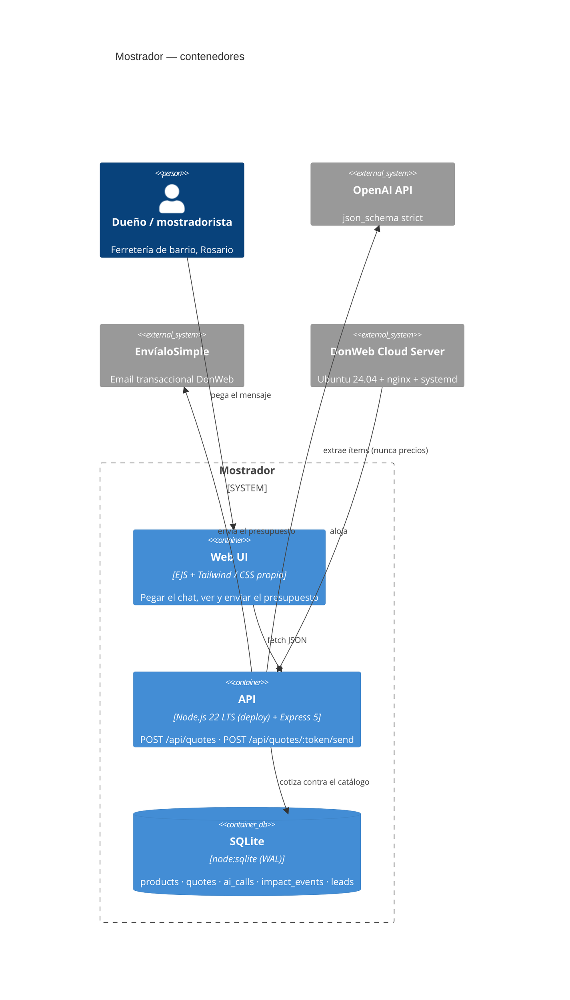

# Mostrador

**El mostrador de tu ferretería que nunca duerme.** El dueño pega el mensaje de WhatsApp del cliente; Mostrador extrae los ítems, los cotiza contra el catálogo real de la ferretería y devuelve un presupuesto listo para mandar por email. De ~20 minutos a ~2.

- **App en vivo:** **https://vps-6576881-x.dattaweb.com/** (DonWeb Cloud Server #6576881, Ubuntu 24.04.5 · nginx → Node `127.0.0.1:3000` → SQLite · TLS Let's Encrypt)
- **Evento:** DonWeb Day Rosario 2026 — Hackatón "Del problema al servidor" (1/11/2026, 15:15 → 18:30)

---

## 1. Problema (la frase, sin adornos)

> Existe **pérdida de ventas por atender pedidos a mano por WhatsApp** que afecta a **ferreterías de barrio de 2 a 6 empleados del Gran Rosario** en **Gran Rosario** debido principalmente a **que cada presupuesto se arma releyendo el chat, buscando precios en una planilla y reescribiéndolo a mano** y genera **≈20 minutos por presupuesto, ~4 h/semana por mostrador**.

**Test de falsabilidad:** *"¿cuántos minutos tarda hoy un mostrador de ferretería de Rosario en armar y enviar un presupuesto?"* — se refuta (o se confirma) con **una** conversación de mostrador. Si el número real es 3 minutos, el producto no tiene razón de existir.

**Alternativa actual (cómo lo resuelven HOY sin nosotros):** el chat de WhatsApp abierto + una planilla de Excel con precios desactualizados + calculadora + reescribir el pedido a mano. El presupuesto se manda cuando el mostrador se libera, no cuando el cliente pregunta.

### Supuestos vs. evidencia

| # | Supuesto | Tipo de evidencia que lo valida o lo mata | Estado |
|---|---|---|---|
| 1 | El mostrador tarda ~20 min por presupuesto | Cronometrar 5 presupuestos reales en 3 ferreterías del Gran Rosario (una tarde de trabajo) | **SUPUESTO** — es el número que sostiene todo el caso de negocio y todavía no lo medimos |
| 2 | Los pedidos llegan por WhatsApp y no por un formulario web | Exportar el historial de consultas de 3 ferreterías y clasificar el canal de origen | **SUPUESTO** — la consigna del hackatón lo asume, pero no lo verificamos |
| 3 | La desocupación del Gran Rosario es la más alta del país | INDEC, EPH 2° trimestre 2026, **Cuadro 3.2** (por áreas geográficas) | **EVIDENCIA** — Gran Rosario **11,5%**, la tasa más alta entre los 31 aglomerados (siguiente: Gran Córdoba 10,5%, Bahía Blanca-Cerri 9,7%, Gran La Plata 8,7%) |
| 4 | El entramado PyME argentino es mayoritariamente micro | CAF, *Las pymes en Argentina* (2024) | **EVIDENCIA** — ≈75% microempresas, ≈19% pequeñas |
| 5 | Un presupuesto digital ordenado ayuda a formalizar | Ninguna fuente directa: es una hipótesis de cadena de cambio, no un dato | **SUPUESTO** — se declara como tal en [la cadena de cambio](docs/impact/cadena-de-cambio.md) |

> **Corrección registrada (no se borra):** el dossier de investigación previo citaba *"≈45% de empleo asalariado no registrado en Gran Rosario (INDEC EPH)"*. Al verificar el PDF primario del INDEC 2T-2026 (`context/raw/Informe2.pdf`) **esa cifra no aparece en el informe**. Se retira del pitch y del README. Lo que sí está verificado y se usa es el 11,5% de desocupación del Cuadro 3.2.

---

## 2. El core flow (lo único que importa)

```
Mensaje de WhatsApp (texto libre, mal escrito, con coma decimal argentina)
        │
        ▼
[1] POST /api/quotes  ──►  OpenAI chat.completions
        │                  response_format: json_schema (strict: true)
        │                  → items[{descripcion_raw, cantidad, unidad, sku_sugerido}]
        │                  → cliente{nombre, telefono, email}, missing_fields[]
        │                  validación zod + 1 reintento de reparación
        │                  si falla 2 veces → extractor determinístico (modo degradado)
        ▼
[2] src/services/catalog.js  ──►  matchItem() contra la tabla `products`
        │                  El modelo NUNCA devuelve precios. El precio sale de acá.
        ▼
[3] Presupuesto cotizado (token público /q/:token)
        │
        ▼
[4] POST /api/quotes/:token/send ──► EnvíaloSimple Transaccional (DonWeb)
        │                  POST https://api.envialosimple.email/api/v1/mail/send
        │                  Authorization: Bearer · from/to/subject/html
        ▼
[5] impact_events  ──►  1 fila por presupuesto (18 min ahorrados), 1 por email
```

**La decisión de arquitectura que sostiene el 25%:** *el LLM extrae, el catálogo cotiza.* El modelo tiene prohibido por prompt devolver importes o SKUs; sólo transcribe descripciones, cantidades y contacto. Un ítem que el matcher no puede vincular con confianza ≥ 0,55 se marca `requiere_revision` en amarillo en vez de inventar un precio. El panel *"¿Cómo se generó?"* de cada presupuesto muestra modelo, modo, latencia, tokens, reparaciones de schema e ítems dudosos — la calidad de la IA es **auditable**, no una afirmación del pitch.

**Momento wow (≤40 s):** pegar el mensaje → 1–4 s → tabla de precios con SKU reales → "Enviar por email" → **se abre el HTML exacto del email que sale** (hoy en modo mock declarado: el cliente HTTP de EnvíaloSimple está escrito contra el contrato publicado, y pasar a live es una variable de entorno) → el contador de `/impacto` sube.

---

## 3. Arquitectura

Mini-arc42 completo en [`docs/architecture/mini-arc42.md`](docs/architecture/mini-arc42.md). Decisiones: [ADR-001 SQLite](docs/architecture/adr-001-sqlite.md) · [ADR-002 sin SSE](docs/architecture/adr-002-no-sse.md) · [ADR-003 email mock por defecto](docs/architecture/adr-003-email-mock-default.md).



**Estructura del repo**

```
app.js                  arranque express, carga .env sin dependencias
src/db.js               adapter: better-sqlite3 → fallback node:sqlite
src/schema.sql          DDL (5 tablas, foreign keys)
src/routes/{index,api}.js
src/services/ai.js      prompt + json_schema + zod + reparación + modo degradado
src/services/catalog.js matcher determinístico (stemming, umbral 0.55)
src/services/presupuesto.js  core flow
src/services/email.js   EnvíaloSimple (live) + mock con preview
src/services/impact.js  impact_events + contadores
src/prompts/extraer-pedido.v1.md   prompt versionado (evidencia del 25%)
src/views/              EJS: index, quote, impacto, 404
prompts/evals/          5 casos dorados + runner
docs/                   pitch, arquitectura, negocio, impacto
context/digests/        base de conocimiento digerida
deploy/                 nginx, systemd, prompt oficial DonWeb, deploy.sh
```

---

## 4. Calidad de la IA (25%) — evidencia ejecutable

Prompt versionado en [`src/prompts/extraer-pedido.v1.md`](src/prompts/extraer-pedido.v1.md) (con reglas anti-alucinación explícitas), schema estricto, validación zod, un reintento de reparación y un camino degradado determinístico.

```
$ npm run evals

  caso                          ok    ms    modo
  ----------------------------------------------------
  caso-1-cantidad-explicita    PASS   245  degraded
  caso-2-dos-items-unidades    PASS    24  degraded
  caso-3-sin-contacto          PASS    14  degraded
  caso-4-contacto-embebido     PASS    89  degraded
  caso-5-vacio                 PASS     7  -

  5/5 casos dorados
```

**Salida real del core flow** (extracción degradada, sin clave de OpenAI):

| Entrada | Salida |
|---|---|
| `hola tenes 200 tornillos del 8x2 y 5 metros de cable 2x1,5? soy Juan, juan@obrasanluis.com` | TOR-8x2 ×200 → $9.000 · CAB-2x15 ×5 → $6.450 · **Total $15.450** · email extraído |
| `buenas tardes, necesito 10 bolsas de cemento y 20 barras de hierro del 8 para el lunes` | CEM-50 ×10 → $98.000 · HIE-8 ×20 → $149.000 · **Total $247.000** |
| `me pasas precio de 2 baldes de latex 20 litros y 3 brochas del 2?` | PIN-LAT20 ×2 → $117.800 · BRO-2 ×3 → $9.600 · **Total $127.400** |
| ` ` (vacío) | **HTTP 422** `{error:{code:"texto_requerido"}}` — nunca un 500 |

### La defensa se prueba, no se afirma

`tests/guard.test.js` demuestra estructuralmente que el modelo **no puede** fijar precios ni ser inyectado, incluso si responde algo hostil. No hace falta la API key para correrla:

```
✔ respuesta hostil del modelo: los precios inventados se ignoran     → 200 × $45 = $9.000, no el $1 que devolvió el "modelo"
✔ inyeccion de prompt en la descripcion no altera otros items        → el ítem envenenado queda en 0 y "revisar"; el legítimo conserva $98.000
✔ el schema estricto rechaza una salida sin los campos requeridos
✔ el schema acepta una salida valida y la normaliza
✔ cantidad no positiva se rechaza en validacion
```

Es la diferencia entre decir "usamos structured outputs" y probar que el importe que ve el cliente **siempre** sale de la tabla `products`.

**Modo degradado:** sin `OPENAI_API_KEY` la app funciona igual con un extractor por reglas y **lo dice en pantalla** (badge ámbar "modo degradado" + `error: OPENAI_API_KEY ausente` visible en el panel de auditoría). No finge que hay IA cuando no la hay.

---

## 5. Verificación (hecha en navegador real, no con curl)

Recorrido manual sobre `127.0.0.1:3000` con Chromium, clic a clic:

| # | Paso | Resultado observado |
|---|---|---|
| 1 | `GET /` | H1 "Del WhatsApp al presupuesto enviado." · badge de modo · KPIs en vivo |
| 2 | clic en "ejemplo 1" | textarea poblado (144 chars) |
| 3 | "Generar presupuesto" | resultado visible, `Listo en 0 ms` (degradado) |
| 4 | tabla | 2 filas, SKUs `TOR-8x2` y `CAB-2x15`, total **$15.450** |
| 5 | panel de auditoría | modelo · modo · latencia · tokens · reparaciones de schema |
| 6 | "Enviar por email" | `Modo mock: ver el email (EnvíaloSimple sin credencial)` |
| 7 | `GET /q/:token` | artefacto imprimible, total $15.450 |
| 8 | `GET /impacto` | 5 presupuestos · 90 min ahorrados · $373.350 cotizados · 1 email |
| 9 | `GET /outbox/:token` | el HTML exacto que EnvíaloSimple entregaría, con el total correcto |
| 10 | viewport 375×667 | sin scroll horizontal (`scrollWidth == innerWidth`) |

Capturas en [`docs/evidencia/`](docs/evidencia/): home, presupuesto generado, artefacto, impacto, mobile.

**Atestación de la verificación en producción (con comandos re-ejecutables y lo que NO se verificó):** [`docs/evidencia/verificacion.md`](docs/evidencia/verificacion.md).

---

## 6. Integración DonWeb

| Producto DonWeb | Uso concreto en este proyecto | Fase |
|---|---|---|
| **Cloud Server** | Aloja la app: Ubuntu 24.04, nginx en 80/443, Node en `127.0.0.1:3000`, systemd | Hackatón (hoy) |
| **EnvíaloSimple Transaccional** | Entrega el presupuesto al cliente al final del core flow | Hackatón (hoy) |
| **Dominios** | `mostrador.com.ar` para el mostrador white-label de cada ferretería | Piloto |
| **EnvíaloSimple Marketing** | El dueño manda la promo de la semana a su cartera de clientes | Piloto |
| **SitioSimple** | Landing pública de la ferretería generada desde el mismo catálogo | Escala |

**Modelo B2B SaaS:** $12.000 ARS/mes por ferretería. Pagan porque el presupuesto sale en 2 minutos en vez de 20 y no se pierden pedidos del turno noche. **Pitch de canal para DonWeb:** cada cliente nuestro consume su Cloud Server y su EnvíaloSimple — somos un canal de venta de su infraestructura hacia 400.000 servicios activos de PyMEs.

---

## 7. Cadena de cambio e impacto

| Hoy (baseline) | Intervención | Cambio esperado | Indicador (IRIS+) |
|---|---|---|---|
| ~20 min por presupuesto a mano en mostrador | Generador IA de presupuestos con catálogo | 20 min → 2 min | *Hours saved* |
| 11,5% de desocupación en Gran Rosario (INDEC EPH 2T-2026, Cuadro 3.2) | Presupuestos y pedidos digitales ordenados por cliente | Más PyMEs con historial y capacidad de sostener empleo | *Jobs Created/Supported (FTE)* |
| ≈75% microempresas (CAF 2024), la mayoría sin herramientas digitales | Mostrador digital sobre infraestructura DonWeb | PyMEs digitalizadas | *SME clients reached* |

ODS **8.3** (formalización y crecimiento de MiPyMEs) y **9.3** (acceso de pequeñas empresas a mercados y cadenas de valor).

**Los 5 números del inversor:** $12.000 ARS/mes por PyME · 5 pilotos objetivo · infraestructura ≈ u$s 3/mes · margen bruto ≈ 80% · 100 PyMEs a 12 meses = $1,2 M ARS de MRR.

---

## 8. Correr en local

```bash
npm install
cp .env.example .env      # OPENAI_API_KEY opcional: sin ella arranca en modo degradado
node src/seed.js          # 15 productos de ferretería
npm start                 # http://127.0.0.1:3000
npm test                  # 12 tests (db, matcher, extractor, guard de precios)
npm run evals             # 5 casos dorados contra el servidor corriendo
```

El proceso escucha en `127.0.0.1:3000` por defecto (regla del deploy oficial de DonWeb: sólo nginx se expone a internet). Para probar desde otro dispositivo de la red local: `HOST=0.0.0.0 npm start`.

### Variables de entorno

| Variable | Default | Qué hace |
|---|---|---|
| `PORT` | `3000` | puerto interno (nginx hace el proxy) |
| `OPENAI_API_KEY` | vacío | si falta → modo degradado determinístico |
| `OPENAI_MODEL` | autodetecta | `gpt-4o-mini` → `gpt-4.1-mini` → `gpt-5-mini` → `gpt-4o` |
| `EMAIL_MODE` | `mock` | `live` usa la API real de EnvíaloSimple |
| `ENVIALOSIMPLE_API_KEY` | vacío | necesaria para `EMAIL_MODE=live` |
| `ENVIALOSIMPLE_FROM` | vacío | remitente de un dominio verificado en la cuenta |
| `DB_PATH` | `data/mostrador.sqlite` | archivo SQLite (WAL) |
| `HOST` | `127.0.0.1` | interfaz de escucha; `0.0.0.0` sólo para prueba en red local |
| `RATE_LIMIT` | activo | `off` desactiva los topes por IP (para correr evals) |
| `RATE_MAX_QUOTES` | `60` | presupuestos por IP por minuto |
| `RATE_MAX_SEND` | `15` | envíos de email por IP por minuto |

---

## 9. Desvíos declarados respecto del blueprint

1. **Sin streaming SSE** (ADR-002): un JSON estructurado de 2-4 s no gana nada stremando tokens y suma riesgo en nginx.
2. **`node:sqlite` con fallback a `better-sqlite3`** (ADR-001): en desarrollo el runtime es Node 26 (ABI 147) y `better-sqlite3` no publica binario precompilado para esa versión; en el servidor corre Node **22.23.4**, donde `node:sqlite` también funciona nativo (verificado con `process.versions.sqlite`). Resultado: cero compilación nativa en ningún entorno.
3. **Email en modo mock por defecto** (ADR-003): la API transaccional de EnvíaloSimple ("API o SMTP Premium") es un add-on **pago** que esta cuenta no tiene contratado — verificado en el panel (Cloud & IaaS → API & SMTP Email: solo la página de contratación, sin servicio activo). Además requiere verificar el dominio remitente. El cliente HTTP está implementado contra el contrato real publicado y pasa a live cambiando `EMAIL_MODE`. La UI nunca dice "enviado" cuando fue mock: dice "Modo mock: ver el email".
4. **Cero dependencias de CDN**: el CSS de utilidades se compila con Tailwind a `public/app.css` (15 KB, `npm run css`) y se sirve local, más ~40 líneas de componentes propios en `src/views/partials/head.ejs`. Verificado: la home no hace **ninguna** petición a un dominio externo, así que si el wifi del lugar falla la página se ve igual.
5. **Base de conocimiento comprimida**: `context/raw/` (PDFs primarios, fuera de git) + `context/digests/` (5 cards). No se versionaron `chunks/` ni un índice de embeddings: el jurado lee el producto, no un pipeline de RAG.

## 10. Deuda técnica conocida

- El matcher es léxico (tokens + stemming). No resuelve sinónimos ("tirafondo" ≠ "tornillo" si el alias no lo lista) ni unidades implícitas.
- Sin autenticación: cualquiera con la URL puede generar presupuestos. Aceptable para la demo, **no** para un piloto real.
- El rate limit es en memoria y por IP: se reinicia con el proceso y no se comparte entre instancias. Sirve para no quemar la clave compartida, no como control de abuso serio.
- El extractor degradado falla con pedidos sin cantidad explícita en orden invertido complejo.
- SQLite de un solo archivo: no soporta más de un proceso escribiendo.
- El baseline de 20 minutos por presupuesto **no está medido**: es el supuesto más riesgoso del caso de negocio.
